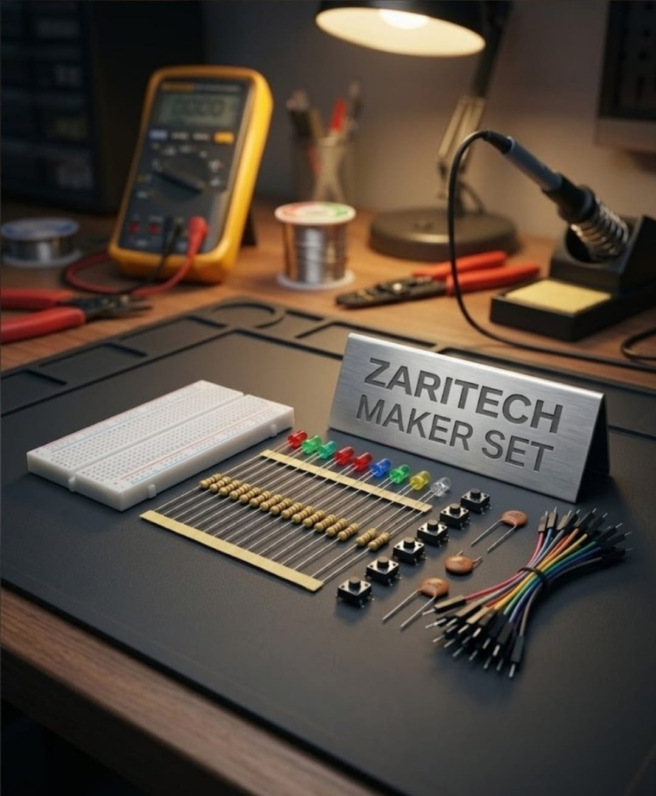

# Zaritech Passive Matrix Decoupling & High-Frequency Prototyping Substrate 🎓⚡

* **Industrial Suite Identifier:** `KIT-03`
* **Curriculum Category:** Passive Grid Noise Filtration, High-Frequency Transient Decoupling & Solderless Bus Layouts
* **Governance Standard:** Zaritech Dynamics Institutional Standard

Welcome to the official repository for the **Zaritech Maker Temel Sarf Paketi** — an enterprise-grade passive component optimization suite, high-frequency hardware decoupling substrate, and advanced prototyping matrix engineered by **Zaritech Systems** (A division of **Zaritech Dynamics**).

### ⚙️ Engineering Paradigm: Power Integrity & High-Frequency Noise Mitigation
When scaling advanced 32-bit ARM Cortex architectures or high-speed wireless transceiver pipelines, systems engineers frequently experience erratic runtime failures caused by voltage ripple and inductive line noise. This advanced laboratory package establishes a robust structural solution via its integrated **High-Frequency Transient Decoupling Substrate**. By introducing high-dielectric ceramic **Filtreleme Kapasitörleri**, students and Ar-Ge specialists master hardware-level ripple damping and decoupling bypass topologies. This passive core stabilizes logic voltage tracks across a high-density breadboard plane, protecting multi-color LED strings and debounced tactile switch arrays from high-frequency electromagnetic interference (EMI).

---

## 🛠️ Hardware & Topology Specs
Our specialized passive component engineering suite is optimized for clean signal paths, dynamic pull-up/down logic loops, and low-impedance power distribution rails:

*   **Transient Decoupling Matrix:** Multi-pack Premium Ceramic Filtering Capacitors optimized for immediate localized energy storage, bypassing alternating current (AC) noise directly to the ground plane.
*   **Passive Protection Arrays:** 20x Precision Mixed Current-Limiting Resistors (330R, 1k Ohm, and alternate calibration values) matched for safe analog signal scaling and diode over-current safeguards.
*   **Physical Diagnostic Array:** 10x High-Efficiency Diffused LEDs (Balanced multi-color cascade setup) serving as physical logic indicators for multi-channel GPIO tracing.
*   **Mechanical Logic Gating Nodes:** 5x High-Retention Momentary Tactile Push Button Switches engineered for secure, wear-free pull-up/down hardware triggering.
*   **Prototyping Backplane Substrate:** 1x Premium High-Durability Medium Solderless Breadboard providing absolute structural and electrical trace stability.
*   **Interconnect Infrastructure:** Zaritech Premium Connection Array consisting of factory-verified high-flexibility color-coded jumper wire paths.

---

## 🗺️ Visual Architecture & Pin Topology
The fundamental hardware signal pathways, decoupling bypass loops, and structural bus alignments for this passive grid matrix are logged below:

### Central Power Integrity & Decoupling Filter Matrix

| Component Interface Node | Hardware Lead Type | Target Infrastructure | Operational Engineering Domain |
| :--- | :--- | :--- | :--- |
| **Ceramic Decoupling Cap** | Lead 1 (Bypass Entry) | Core MCU VCC Rail | High-Frequency Local Ripple Damping |
| | Lead 2 (Bypass Exit) | Unified System Ground | Return Path to Low-Impedance Ground |
| **Tactile Push Button**   | Input Pole 1A | External Logic Source | Hardwired Current Gate Trigger |
| **Current-Limiting Resistor**| Inline Resistor Substrate| LED Anode / Signal Path | Passive Thermal & Over-Current Safeguard |
| **Physical Logic LED**    | Diffused Cathode (-) | Unified System Ground | Visual Voltage State Indication |

### Academic Circuit Verification File
Since this specialized sarf framework operates entirely on passive hardware decoupling loops and hardwired prototyping substrates to stabilize external microcontrollers, it does not require an independent software binary sketch. To maintain repository health and pass our automated continuous integration (CI) test lines, a validated structural decoupling schema configuration file is provided inside our deployment path.

🔗 **[Click here to view the hardware filtration layout loop](./firmware/hardware_filtration_map.txt)**

---

## 📸 Hardware Layout

---

## 📥 Commercial Acquisition & Distribution
To purchase factory-certified **Zaritech Maker Temel Sarf Paketi Complexes**, wholesale corporate laboratory stock takviyesi supplies, or academic hardware-level power integrity curriculum resources, please bridge with our logistics network via our official [Zaritech Labs Instagram](https://instagram.com).

---

## ⚖️ License & Corporate Governance
This infrastructure is maintained under the **MIT License** and governed under the rigorous engineering frameworks of **Zaritech Dynamics**.

*May Allah grant us success on this path.*
