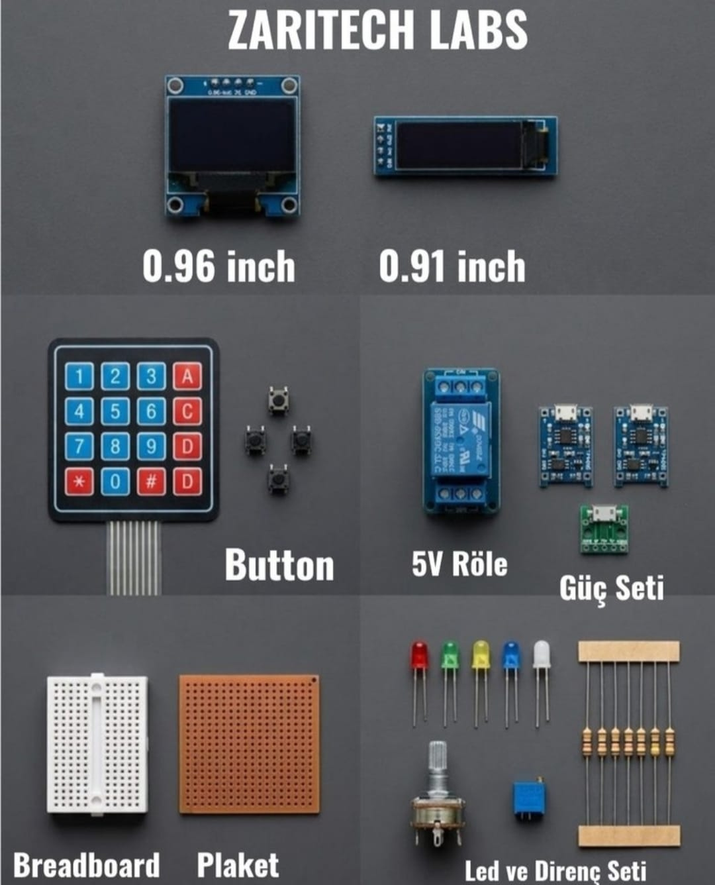

# Zaritech Advanced PMIC Topologies, Dual-OLED Buffering & HMI Matrix Substrate 🎓⚡

* **Industrial Suite Identifier:** `KIT-04`
* **Curriculum Category:** Thermal-Regulated Lithium Charging, Asynchronous Dual-Display Gating & Rigid Permanent Prototyping
* **Governance Standard:** Zaritech Dynamics Institutional Standard

Welcome to the official repository for the **Zaritech Ekran, Güç ve Giriş Elemanları Kompleksi** — an enterprise-grade power management infrastructure, concurrent dual-OLED frame-buffering pipeline, and matrix access control validation platform engineered by **Zaritech Systems** (A division of **Zaritech Dynamics**).

### ⚙️ Engineering Paradigm: Power Delivery Optimization & Heterogeneous Dual-Display Renders
When engineering high-reliability industrial instruments or wearable medical telemetry nodes, system architectures demand autonomous charging grids paired with scaled visual output form-factors. This advanced suite resolves these complex constraints through its integrated **Thermal-Regulated Lithium PMIC Arrays** and **Asynchronous Dual-OLED Screen Buffering** pipelines. By deploying dual independent linear **TP4056 Charging Modules** alongside a dedicated **Micro USB Power Breakout Node**, developers isolate logic power domains from battery charging cycles. The framework guides engineers on routing data concurrently across a standard square 0.96" OLED and an ultra-narrow 0.91" OLED panel via shared or isolated I2C data streams, utilizing a 4x4 matrix keypad for encrypted input validation.

---

## 🛠️ Hardware & Topology Specs
Our mission-critical power and visual instrumentation complex is optimized for low-loss power delivery, multi-drop I2C bus tracking, and permanent laboratory soldering migrations:

*   **Autonomous Power Management ICs (PMIC):** 2x TP4056 High-Efficiency Lithium-Ion Battery Charging Subsystems with integrated thermal feedback and constant-current/constant-voltage (CC/CV) control loops.
*   **Power Distribution Bus:** 1x High-Durability Micro USB Breakout Board converting raw external input voltages into clean logic power paths.
*   **Dual Visual Interface Array:**
    *   **0.96" High-Contrast I2C OLED Screen:** Square form-factor panel optimized for full telemetry graphics and interface matrices.
    *   **0.91" Ultra-Narrow I2C OLED Screen:** Compact rectangular form-factor panel calibrated for smart wearable and low-profile spatial diagnostic pipelines.
*   **HMI Access Matrix & Analog Controls:**
    *   **4x4 Flexible Keypad Matrix:** Multiplexed digital input grid for secure password entry and parameter threshold overrides.
    *   **10k Potentiometer & Precision Trimpot Node:** Dual analog voltage dividers for precise analog calibration loops.
*   **Galvanic Isolation Gateway:** 5V Electromagnetic Relay Module supporting true **10A (250VAC / 30VDC)** load manipulation.
*   **Substrate Array & Passives:** 1x Mini Breadboard for volatile rapid testing, 1x 5x5 cm Rigid FR4 Prototyping Pertinax Board for permanent lab soldering, 5x Diffused Status LEDs, and a mixed passive resistor matrix (330R, 1k, 10k).

---

## 🗺️ Visual Architecture & Pin Topology
The streamlined hardware signal pathways, shared I2C telemetry lines, and multi-drop bus topologies for this advanced sub-system are detailed below:

### Central I2C Telemetry & HMI Matrix Routing Grid

| Peripheral Module | Component Pin Name | Target Controller Interface Node | Engineering Domain Context |
| :--- | :--- | :--- | :--- |
| **0.96" Display Core** | SDA / SCL (Bus 1) | Main I2C Data/Clock Rails | Primary Telemetry Layout Render |
| **0.91" Display Core** | SDA / SCL (Bus 1) | Shared I2C (Alternate Address 0x3C/3D)| Secondary Wearable Status Log |
| **TP4056 Substrate**  | B+ / B- Pins | Lithium-Ion Cell Contacts | Constant CC/CV Energy Harvesting |
| **4x4 Input Matrix**  | Row/Col Header Bus | Digital Interrupt & IO Array Pins | Cryptographic Access Control Token |
| **5V Power Relay**    | Control IN Signal  | High-Drive Logic Output Pin | Galvanic High-Current Isolation |

### Industrial Firmware Implementation
The full, multi-layered firmware solution executing asynchronous dual-canvas display sweeps, independent I2C bus address multiplexing, and encrypted keypad matrix scanning is safely isolated within our production codebase.

🔗 **[Click here to view the full operational source code](./firmware/main.cpp)**

---

## 📦 Package Components
*Here is the visual index of the high-grade components included in the KIT-10 platform:*

 

## ⚙️ Hardware Layout & Interfacing Schematic
*The following standardized 32-bit ARM topology maps the exact point-to-point connections over the shared I2C bus and analog transduction node:*

---

## 📥 Commercial Acquisition & Distribution
To purchase factory-certified **Zaritech Ekran, Güç ve Giriş Elemanları Kompleksi Sets**, secure university technical laboratory inventory supplies, or request advanced power integrity training notes, please coordinate with our supply logistics channel via our official [Zaritech Labs Instagram](https://instagram.com).

---

## ⚖️ License & Corporate Governance
This infrastructure is maintained under the **MIT License** and governed under the rigorous engineering frameworks of **Zaritech Dynamics**.

*May Allah grant us success on this path.*
