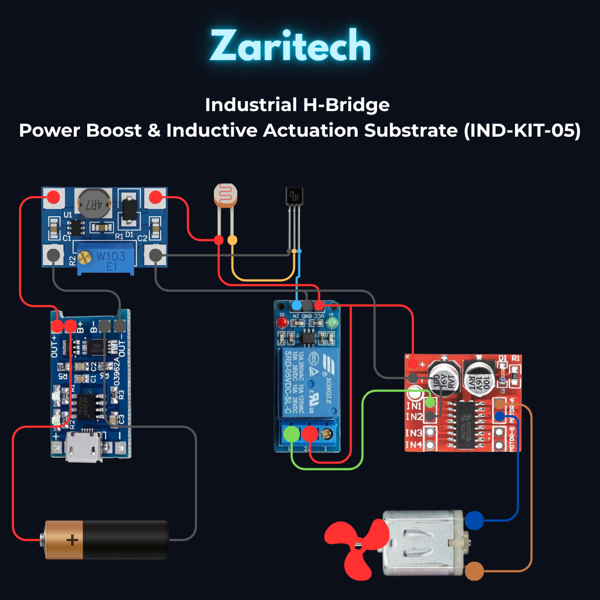

# Zaritech Industrial H-Bridge Power Boost & Inductive Actuation Substrate 🎓⚙️

* **Industrial Suite Identifier:** `KIT-05`
* **Curriculum Category:** High-Current H-Bridge Motor Driving, High-Frequency Boost Regulation & Transistor Base Current Safeguards
* **Governance Standard:** Zaritech Dynamics Institutional Standard

Welcome to the official repository for the **Zaritech Güç, Şarj ve Motor Sürücü Kompleksi** — an enterprise-grade power electronics infrastructure, dynamic H-bridge fluid propulsion network, and autonomous photo-transduction system engineered by **Zaritech Systems** (A division of **Zaritech Dynamics**).

### ⚙️ Engineering Paradigm: Multi-Rail Power Conversion & Inductive Transient Isolation
When engineering automated robotics drivetrains or temperature-controlled industrial cooling complexes, system layouts face dual challenges: routing high-current inductive spikes and stabilizing multi-rail voltage lines. This advanced laboratory suite resolves these boundaries via its integrated **High-Frequency Step-Up Boost Regulation** and **Asynchronous H-Bridge PWM Telemetry** pipelines. By isolating low-voltage processing logic from heavy inductive loads using an onboard **L298N Dual Motor Driver Substrate** and a galvanic **5V Relay Module**, developers prevent back-EMF processor lockups. The infrastructure teaches engineers how a single **TP4056 PMIC** tracks lithium energy harvesting, while an **SX1308 Boost Conversion Network** steps cell voltage cleanly up to a high-torque 5V/12V output rail, utilizing a discrete **2N2222 Transistor Base-Current Protection Gating** string for secure software-defined actuation.

---

## 🛠️ Hardware & Topology Specs
Our mission-critical power electronics and inductive propulsion complex is optimized for high-frequency PWM switching, dual-rail voltage management, and permanent laboratory FR4 board soldering:

*   **Inductive H-Bridge Controller Substrate:** L298N Dual H-Bridge Motor Driver Module equipped with high-durability internal Darlington transistors and freewheeling protection diodes, optimized for bidirectional current control up to **2A per channel**.
*   **Galvanic Isolation Gateway:** 5V Electromagnetic Single-Channel Relay Module supporting true **10A (250VAC / 30VDC)** synchronous heavy-load power control loop routing.
*   **Fluid Propulsion Subsystem:** High-RPM Brushed DC Prototyping Motor paired with a high-aerodynamic efficiency fluid propeller fan.
*   **High-Frequency Step-Up PMIC Grid:** SX1308 Synchronous Boost DC-DC Regulator Module operating on a high-frequency switching pipeline to step up low-profile cell potentials cleanly.
*   **Autonomous Battery Harvester:** TP4056 Lithium-Ion Linear Charging Infrastructure with integrated thermal feedback and continuous constant-current/constant-voltage (CC/CV) control logic.
*   **Discrete Gating & Sensory String:** 
    *   **2N2222 NPN Silicon Transistor Node:** High-speed switching transistor for software-controlled micro-actuation logic.
    *   **5mm Ambient LDR Sensor:** High-sensitivity light-dependent resistor for otonom daylight-tracking or proximity mapping loops.
*   **Substrate Board & Passives:** 1x 10x10 cm Large Rigid Solderable Prototyping Pertinax Board, 1x High-Capacity 3.7V Lithium-Ion Battery Node with single low-resistance dock, 8x Precision **1k Ohm Base Resistors** strategically inline-mapped to enforce safe current limits on microcontroller I/O pins, and 5x Diffused Status LEDs.

---

## 🗺️ Visual Architecture & Pin Topology
The streamlined hardware signal pathways, multi-rail voltage grids, and logic routing channels for this power complex are logged below:

### Central Power Electronics & Inductive Drive Grid

| Core Module Sub-System | Hardware Pin Name | Target Controller Interface | Engineering Operational Context |
| :--- | :--- | :--- | :--- |
| **L298N Driver Substrate**| IN1 / IN2 Pins | Digital Pins (PWM Capable) | Asynchronous H-Bridge Phase Control |
| | OUT1 / OUT2 Terminals| DC Motor Pins | Bidirectional Current Inductive Drive |
| **SX1308 Boost Converter**| VIN+ / VIN- Ports | 18650 Battery Rail Contacts | Low-Profile Cell Potential Input |
| | VOUT+ / VOUT- Rails | L298N Motor Power VMS Rail | High-Torque Stepped-Up DC Power Rail |
| **2N2222 Transistor** | Base (B) Pin via 1k | Microcontroller Output Pin | Transistor Base-Current Protection Gate |
| | Collector / Emitter | Relay IN Signal / GND | Software-Isolated Relay Low-Side Switch |

### Industrial Firmware Implementation
The bare-metal, production-grade source library utilizing C/C++ architectures to execute hardware PWM timer clock generation, automated LDR analog lux scaling boundaries, and step-by-step motor driver direction sequencing is safely isolated within our code tree.

🔗 **[Click here to view the full operational source code](./firmware/main.cpp)**

---

## 📸 Hardware Layout

---

## 📥 Commercial Acquisition & Distribution
To buy factory-certified **Zaritech Güç, Şarj ve Motor Sürücü Kompleksi Sets**, request bulk quotes for university advanced engineering laboratory suites, or access our power semiconductor layout textbooks, please coordinate with our supply logistics channel via our official [Zaritech Labs Instagram](https://instagram.com).

---

## ⚖️ License & Corporate Governance
This infrastructure is maintained under the **MIT License** and governed under the rigorous engineering frameworks of **Zaritech Dynamics**.

*May Allah grant us success on this path.*
