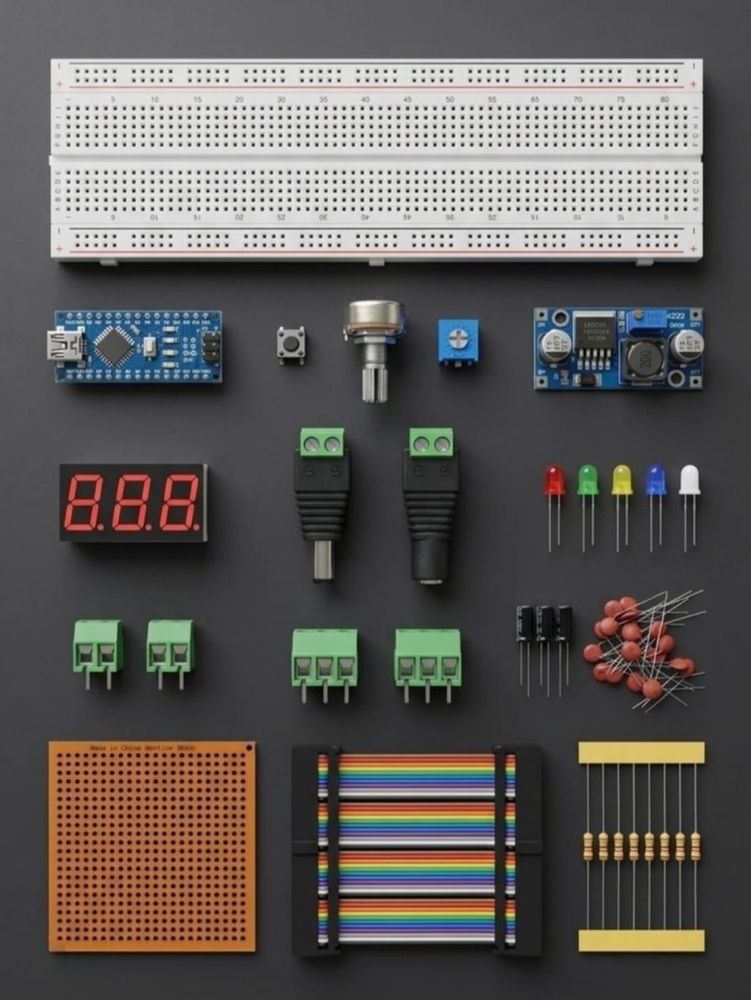

# Zaritech Step-Down Buck Regulation, Multiplexed Display & Power Bus Infrastructure 🎓⚡

* **Industrial Suite Identifier:** `KIT-06`
* **Curriculum Category:** High-Efficiency Step-Down Switching, Segment Multiplexing & Institutional Power Bus Routing
* **Governance Standard:** Zaritech Dynamics Institutional Standard

Welcome to the official repository for the **Zaritech Voltaj Regülatörlü Laboratuvar Seti** — an enterprise-grade power delivery infrastructure, asynchronous segment-multiplexing pipeline, and rigid permanent PCB terminal routing platform engineered by **Zaritech Systems** (A division of **Zaritech Dynamics**).

### ⚙️ Engineering Paradigm: Power Delivery Optimization & Hardware Latch Verifications
When engineering advanced instrumentation setups or industrial automated test benches, system architectures demand a highly stable, adjustable power rail alongside a localized numerical diagnostics dashboard. This advanced laboratory package addresses these complex boundaries via its integrated **Asynchronous Dynamic Step-Down Buck Switching** and **Institutional Triple-Lane Power Bus Topologies**. By deploying a high-current **LM2596 Buck Converter Subsystem** combined with a dual configuration of high-retention **DC Jack & PCB Klemens Arrays**, developers learn to route heavily filtered, multi-rail voltages cleanly to a compact **Arduino Nano V3 Core**. The framework guides engineers on driving dynamic numeric telemetry across a 3-Digit Seven Segment display while managing noise-free structural switching.

---

## 🛠️ Hardware & Topology Specs
Our mission-critical power distribution and visual telemetry complex is optimized for low-loss power delivery, stable transient response steps, and permanent laboratory FR4 board soldering:

*   **High-Efficiency Power Converter Subsystem:** 1x LM2596 Step-Down Adjustable DC-DC Buck Regulator Module operating on a high-frequency switching frequency to step down high-voltage external lines cleanly into a safe logic-level power rail.
*   **Micro Computing Node Core:** Arduino Nano V3 development engine powered by the robust 8-bit ATmega328P architecture, tailored for high-density breadboard array docking and parallel bus routing.
*   **Visual Telemetry Display:** 3-Digit 7-Segment Common Anode Display Array for sharp, high-luminance numeric tracking and parameter menu index visualization.
*   **Power Bus Interconnect Terminal Array:**
    *   **2x DC Jack Input & 2x DC Jack Output Sockets:** Heavy-duty, low-resistance power entry/exit nodes for stable grid alignment.
    *   **4x Premium PCB Screw Klemens Modules:** Rigid terminal blocks for secure, vibration-resistant current path clamping.
*   **Analog Calibration Node Blocks:** 2x 10k Potentiometers and 2x Precision Trimpot Arrays for multi-channel analog voltage division and reference adjustments.
*   **Substrate Backplane & Passives:** 1x Large Prototyping Breadboard (830 Tie-Points Layout), 1x 5x5 cm Rigid FR4 Solderable Plaket, 2x Toggle ON/OFF Switches, 4x Momentary Tact Button Arrays, 40-piece high-durability color-coded jumper matrix, 5x Multi-Color Diffused LEDs, a mixed resistor matrix (330R, 1k, 10k), and a high-dielectric **Ceramic & Electrolytic Kapasitör/Kondansatör Noise Filtering Set**.
*   **Institutional Compliment Components:** 1x Premium Mixed **DIP Entegre Soket Seti Pack** for clean socketed chip extraction and hardware bus routing safeguards.

---

## 🗺️ Visual Architecture & Pin Topology
The streamlined hardware signal pathways, shared multiplex display lines, and multi-rail voltage bus configurations for this advanced lab infrastructure are detailed below:

### Central Power Integrity & Terminal Routing Grid

| Core Module Sub-System | Hardware Pin Name | Target Interface Node | Engineering Operational Context |
| :--- | :--- | :--- | :--- |
| **LM2596 Buck Module** | IN+ / IN- Terminals | External High-Voltage Supply | Raw DC Voltage Rail Input |
| | OUT+ / VOUT- Rails | Breadboard Power Bus Line | Stepped-Down Regulated VCC Output |
| **PCB Screw Klemens**  | Terminal Clamps 1-4 | Shared Power Plane / Load | Rigid High-Current Output Paths |
| **3-Digit Seven Seg**  | Segment Multi-Bus  | Nano Digital Pins D5 to D11 | Multiplexed Character Mapping |
| **Toggle Power Switch**| Inline Latch Pins  | VCC Distribution Rail | Master Mechanical Safety Interlock |

### Industrial Firmware Implementation
The full, modular software solution executing high-speed non-blocking display multiplexing sweeps, analog pot telemetry filtering arrays, and software-defined power threshold latching is safely isolated within our production codebase.

🔗 **[Click here to view the full operational source code](./firmware/main.cpp)**

---

## 📸 Hardware Layout

---

## 📥 Commercial Acquisition & Distribution
To purchase factory-certified **Zaritech Voltaj Regülatörlü Laboratuvar Sets**, secure bulk engineering faculty laboratory inventories, or download institutional power topology blueprints, please bridge with our logistics network via our official [Zaritech Labs Instagram](https://instagram.com).

---

## ⚖️ License & Corporate Governance
This infrastructure is maintained under the **MIT License** and governed under the rigorous engineering frameworks of **Zaritech Dynamics**.

*May Allah grant us success on this path.*
