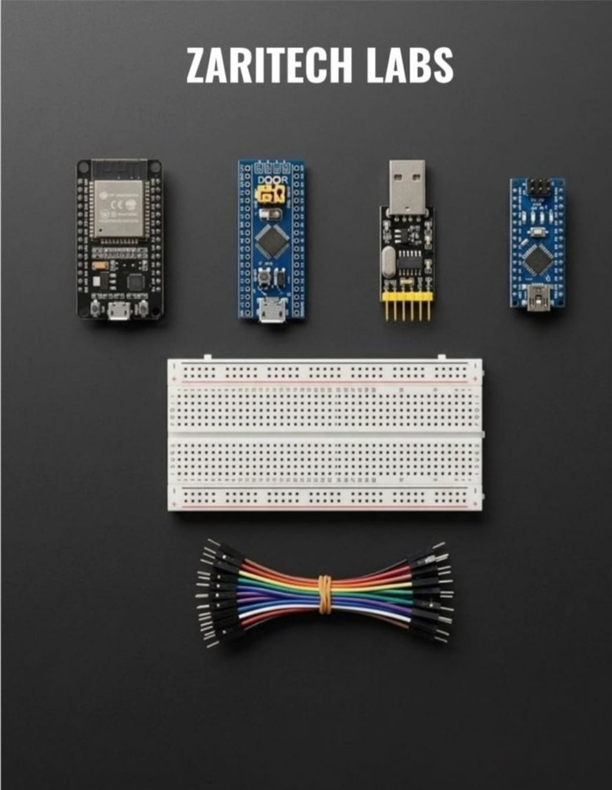
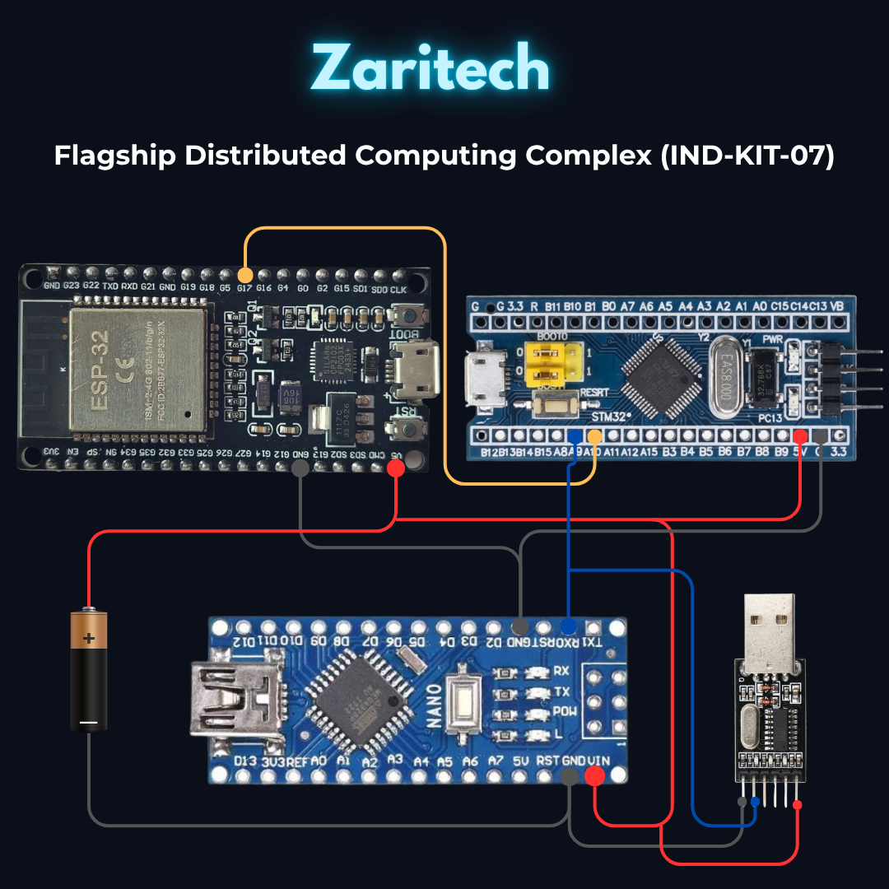

# Zaritech Heterogeneous Multi-Architecture Substrate & Inter-Processor Bus Gateway 🎓🔬

* **Industrial Suite Identifier:** `KIT-07`
* **Curriculum Category:** Heterogeneous Computing, Asynchronous Inter-Processor Protocols & Multi-Architecture Verification
* **Governance Standard:** Zaritech Dynamics Institutional Standard

Welcome to the official repository for the **Zaritech 3'lü Mikrodenetleyici Laboratuvar Seti** — a high-performance, multi-architecture hardware development matrix, cross-compilation cluster, and advanced communication bus gateway engineered by **Zaritech Systems** (A division of **Zaritech Dynamics**).

### ⚙️ Engineering Paradigm: Multi-Core Heterogeneous Processing & Inter-Bus Handshakes
When architecture validation arrays for aerospace tracking frameworks, localized edge computing matrices, or advanced distributed automation structures are deployed, single-chip systems create single points of failure. This flagship laboratory complex solves this computational bottleneck by establishing a **Heterogeneous Multi-Architecture Substrate**. By consolidating an 8-bit AVR processing node (**Arduino Nano V3**), a 32-bit high-frequency ARM Cortex-M3 core (**STM32F103C8T6 Blue Pill**), and a 32-bit dual-core high-speed wireless engine (**ESP32 38-Pin NodeMCU**), students and R&D specialists master hardware cross-scaling. The framework guides engineers on deploying synchronized **Inter-Processor Bus Gateways** via UART, SPI, and I2C lines using an integrated **CH340 USB-TTL Serial Converter** to monitor distributed register actions across a unified breadboard plane.

---

## 🛠️ Hardware & Topology Specs
Our flagship multi-architecture computing cluster is optimized for parallel multi-drop bus topologies, discrete logic-level isolation, and high-density heterogeneous network testing:

*   **Wireless Edge Computing Core:** ESP32 38-Pin Development Engine driven by a high-frequency 32-bit dual-core Xtensa processor, featuring integrated native Wi-Fi/Bluetooth stacks and advanced hardware cryptographic engines.
*   **32-Bit ARM Computing Node:** STM32F103C8T6 "Blue Pill" industrial board containing a 32-bit ARM Cortex-M3 processing unit operating up to 72MHz, featuring integrated direct memory access (DMA) paths and rich peripheral hardware trees.
*   **Universal Prototyping Computing Node:** Arduino Nano V3 micro form-factor hardware platform running on a reliable 8-bit ATmega328P layout, optimized for local sensor polling.
*   **Asynchronous Serial Telemetry Bridge:** CH340 USB-to-TTL Serial Transceiver Module providing native USB communication layers to inject bare-metal firmware loads directly onto the ARM Cortex flash registers.
*   **Prototyping Grid Substrate:** 1x Premium High-Durability Large Solderless Breadboard providing a massive matrix layout to seat all three processing architectures simultaneously with unified ground tracks.
*   **Interconnect Infrastructure:** Factory-verified premium high-flexibility color-coded jumper matrix bundle calibrated for noise-free high-frequency digital communication bus routing.

---

## 🗺️ Visual Architecture & Pin Topology
The streamlined hardware signal pathways, shared distributed buses, and inter-processor data communication channels for this multi-architecture complex are logged below:

### Central Inter-Processor Bus & Telemetry Routing Grid

| Processing Node A | Peripheral Interface | Processing Node B | Operational Engineering Domain |
| :--- | :--- | :--- | :--- |
| **ESP32 Core (32-Bit)** | UART TX2 / RX2 Lines | **STM32 Core (ARM)** | High-Speed Wireless-to-ARM Data Pipe |
| **STM32 Core (ARM)** | PA9 (TX) / PA10 (RX) | **CH340 USB Bridge** | Bare-Metal Serial Debug Logging & Flash |
| **Arduino Nano (8-Bit)**| Hardware I2C Bus | **ESP32 Core (32-Bit)** | Low-Power Sensor Aggregation Bus |
| **All MCU Nodes** | Unified GND Pins | Shared Ground Rail | Common Low-Impedance Reference Plane |

### Industrial Firmware Implementation
The master multi-architecture firmware suite containing decoupled cross-platform C/C++ source code scripts (managing asynchronous serial packet parsing, 32-bit-to-8-bit logic alignment data frames, and multi-drop master/slave communication handshakes) is safely isolated within our production code tree.

🔗 **[Click here to view the full operational source code](./firmware/)**

---

## 📦 Package Components
*Here is the visual index of the high-grade components included in the KIT-10 platform:*

 

## ⚙️ Hardware Layout & Interfacing Schematic
*The following standardized 32-bit ARM topology maps the exact point-to-point connections over the shared I2C bus and analog transduction node:*

---

## 📥 Commercial Acquisition & Distribution
To buy the factory-certified flagship **Zaritech 3'lü Mikrodenetleyici Laboratuvar Complexes**, request bulk wholesale institutional university laboratory array quotes, or access advanced distributed computing courseware, please coordinate with our supply logistics channel via our official [Zaritech Labs Instagram](https://instagram.com).

---

## ⚖️ License & Corporate Governance
This infrastructure is maintained under the **MIT License** and governed under the rigorous engineering frameworks of **Zaritech Dynamics**.

*May Allah grant us success on this path.*
