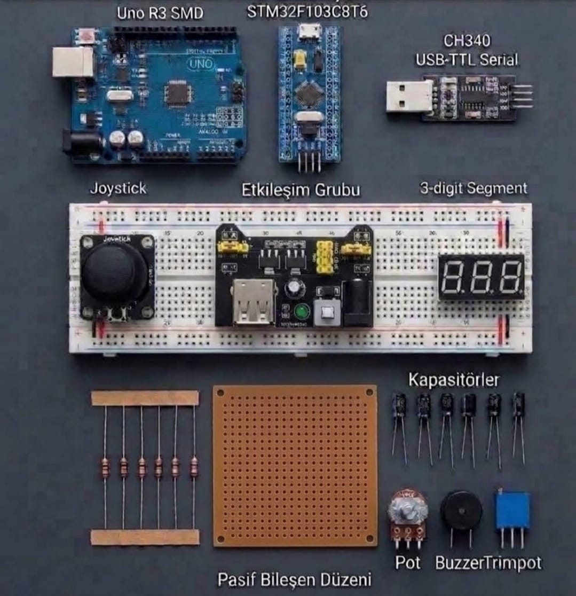

# Zaritech Cross-Architecture Validation, HMI Navigation & Regulated Power Hub 🎓🔬

* **Industrial Suite Identifier:** `KIT-08`
* **Curriculum Category:** Cross-Architecture Code Optimizations, Dual-Axis Coordinate Mapping & Dynamic Voltage Regulation
* **Governance Standard:** Zaritech Dynamics Institutional Standard

Welcome to the official repository for the **Zaritech Arduino ve STM32'li Deney Seti** — a high-performance cross-architecture validation matrix, dual-axis proportional HMI navigation engine, and multi-rail regulated power complex engineered by **Zaritech Systems** (A division of **Zaritech Dynamics**).

### ⚙️ Engineering Paradigm: Heterogeneous Instruction Optimization & Dual-Rail Regulation
When evaluating real-time control algorithms for industrial CNC paths or avionics sensory nodes, development teams must test software footprints across varying silicon instructions (RISC 8-bit vs. ARM 32-bit). This advanced laboratory complex answers this multi-platform challenge through its integrated **Asynchronous Cross-Architecture Gating** infrastructure. By setting up an 8-bit AVR controller (**Arduino Uno R3 SMD**) parallel to a 32-bit ARM Cortex-M3 core (**STM32F103C8T6 Blue Pill**), students parse the math efficiencies of identical algorithm scripts. The layout implements a dedicated **Dual-Axis Analog Coordinate Filtering** block via the joystick module, streaming data to a 3-Digit segment visual display while an autonomous **Breadboard Power Module** regulates multi-rail voltage tracks safely.

---

## 🛠️ Hardware & Topology Specs
Our mission-critical cross-architecture simulation substrate is optimized for multi-drop asynchronous serial routing, low-impedance transient decoupling, and permanent circuit prototyping:

*   **32-Bit ARM Computing Node:** STM32F103C8T6 "Blue Pill" development engine driven by a high-frequency ARM Cortex-M3 processor core, featuring internal direct memory access (DMA) loops and hardware debug lines.
*   **8-Bit Universal Prototyping Node:** Arduino Uno R3 development board running on the low-profile ATmega328P SMD architecture, configured for global prototyping validation.
*   **Dual-Rail Voltage Regulator Subsystem:** 1x Premium Breadboard Power Module featuring integrated 3.3V and 5V linear step-down rails, mechanical power switches, and dual USB output docks.
*   **Asynchronous Serial Telemetry Bridge:** CH340 USB-to-TTL Serial Transceiver Module engineered to interface bare-metal ARM firmware logs directly with host computing terminals.
*   **HMI Proportional Vector Input:** 1x Dual-Axis Analog Joystick Module providing continuous potentiometric tracking metrics and an integrated Z-axis selection switch.
*   **Visual Telemetry Dashboard:** 3-Digit Seven Segment Display Array optimized for high-refresh multiplexed data character rendering.
*   **Substrate Matrix & Passives:** 1x Massive Solderless Breadboard, 1x 10x10 cm Solderable Prototyping Plaket, 1x Active Buzzer Node, 1x 10k Potentiometer, 1x Precision Trimpot, an inline passive resistor matrix, and a high-dielectric **Ceramic/Electrolytic Transient Decoupling Capacitor Array**.

---

## 🗺️ Visual Architecture & Pin Topology
The hardware signal pathways, shared distributed buses, and cross-platform communication tracks for this experimental hub are mapped below:

### Central Instruction Matrix & Inter-MCU Interface Grid

| Peripheral Module Node | Component Pin Name | Target Interface Node | Operational Engineering Domain |
| :--- | :--- | :--- | :--- |
| **Analog Joystick** | VRX / VRY Pins | Uno Analog A0 / A1 | Coordinate Tracking Telemetry |
| **Power Module**     | 5V / 3.3V Pin Rails | Breadboard Dual Rails | Unified Dual-Volt Power Distribution |
| **CH340 Serial Bridge**| TXD / RXD Interface | STM32 PA10 / PA9 Pins | ARM Bare-Metal Firmware Injections |
| **3-Digit Segment** | Multiplex Bus Lines | Uno Digital Pins D2-D10| Local Segment Multiplex Displays |
| **All System Nodes** | Common Ground Pins | Shared Power Ground Rail| Low-Impedance Reference Plane |

### Industrial Firmware Implementation
The full, multi-layered cross-platform firmware suite containing standalone C/C++ resource libraries (handling asynchronous cross-architecture serialization, debounced proportional joystick mapping vectors, and high-frequency segment display multiplexing sweeps) is safely isolated within our code tree.

🔗 **[Click here to view the full operational source code](./firmware/)**

---

## 📸 Hardware Layout

---

## 📥 Commercial Acquisition & Distribution
To purchase factory-certified **Zaritech Arduino ve STM32'li Deney Sets**, secure wholesale institutional university laboratory array quotas, or access our advanced cross-compilation reference books, please bridge with our logistics network via our official [Zaritech Labs Instagram](https://instagram.com).

---

## ⚖️ License & Corporate Governance
This infrastructure is maintained under the **MIT License** and governed under the rigorous engineering frameworks of **Zaritech Dynamics**.

*May Allah grant us success on this path.*
