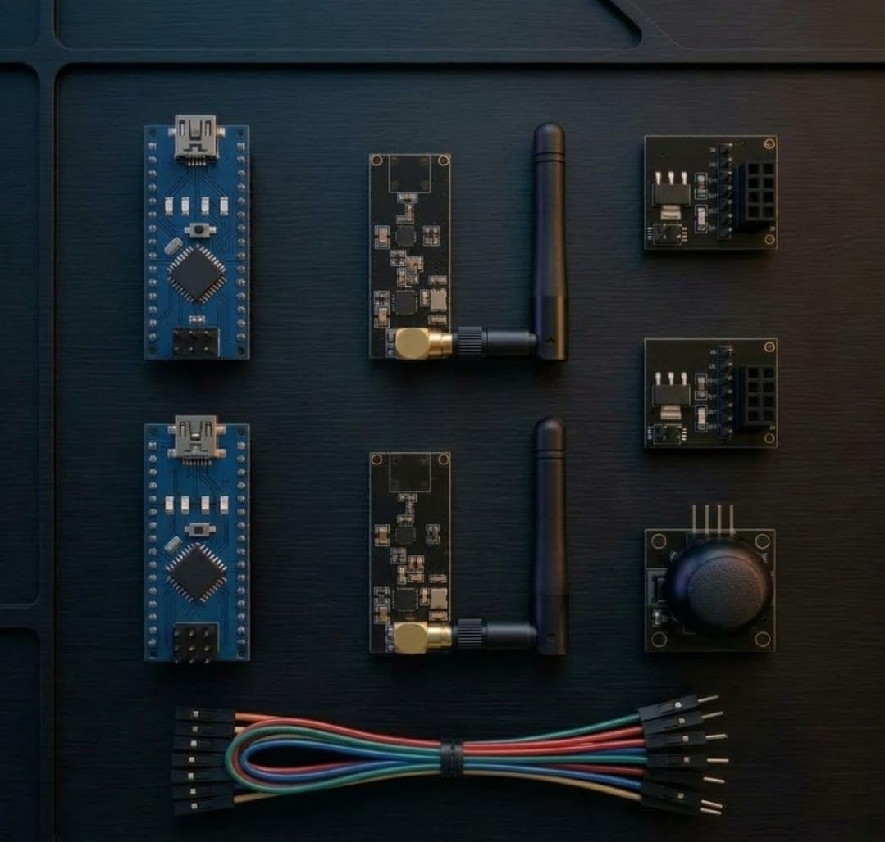

# Zaritech Industrial RF Telemetry & Asynchronous Packet Transceiver Substrate 🎓📡

* **Industrial Suite Identifier:** `KIT-09`
* **Curriculum Category:** Long-Range Radio Frequency (RF) Topologies, SPI Bus Packet Serialization & Voltaric Transient Damping
* **Governance Standard:** Zaritech Dynamics Institutional Standard

Welcome to the official repository for the **Zaritech Uzun Menzilli Kablosuz Haberleşme Kompleksi** — an enterprise-grade point-to-point RF telemetry infrastructure, asynchronous packet serialization pipeline, and voltage-buffered transceiver substrate engineered by **Zaritech Systems** (A division of **Zaritech Dynamics**).

### ⚙️ Engineering Paradigm: Inductive Transient Damping & RF Link Stability
In long-range wireless communication development for unmanned aerial vehicles (UAVs), remote agro-telemetry arrays, or industrial tracking networks, standard RF setups suffer from chronic decoupling. When the transceiver shifts from idle mode to high-power transmission bursts, sudden current spikes pull down raw logic power lines, inducing link dropouts and packet serialization failure modes. This advanced laboratory platform systematically isolates this risk by deploying dedicated **Transient Voltage Buffer Substrates** (NRF24L01 Regulator Adapters). By filtering linear logic rails and pairing twin high-frequency **NRF24L01 2.4GHz RF Transceivers** with high-gain external SMA antennas alongside a dual **Arduino Nano V3 Core** layout, engineers master hardware-level SPI bus multi-drop routing, packet payload structuring, and real-time kinematic steering control loops without structural data attenuation.

---

## 🛠️ Hardware & Topology Specs
Our mission-critical radio frequency computing cluster is optimized for long-range ISM band transactions, high-speed SPI data bursts, and low-noise decentralized control loops:

*   **Long-Range RF Transceiver Modules:** 2x NRF24L01+ 2.4GHz Wireless Silicon Emitters equipped with high-gain external omnidirectional SMA antennas, supporting Nordic Enhanced ShockBurst™ hardware protocol accelerators and multi-drop auto-acknowledgement tracking.
*   **Transient Voltage Buffer Substrates:** 2x Dedicated NRF24L01 DC-DC Regulator Modules with integrated surface-mount filtering capacitors, stabilizing loose power tracks and dropping raw VCC inputs down to a ripple-free 3.3V logic rail.
*   **Decentralized Dual-MCU Nodes:** 2x Arduino Nano V3 micro computing engines utilizing the 8-bit ATmega328P processing architecture, split into dedicated **Autonomous Transmitter (TX)** and **Remote Receiver (RX)** network topologies.
*   **HMI Kinematic Command Matrix:** 1x Dual-Axis Analog Joystick Module utilizing continuous proportional voltage division for high-accuracy horizontal (Pan) and vertical (Tilt) vector tracking.
*   **Interconnect Infrastructure:** Factory-verified premium high-flexibility color-coded jumper wire array optimized for noise-free Serial Peripheral Interface (SPI) high-frequency hardware clock synchronization.

---

## 🗺️ Visual Architecture & Pin Topology
The hardware signal pathways, high-speed SPI bus distributions, and hardware CE/CSN control registers for this transceiver infrastructure are detailed below:

### Central SPI Communication & Telemetry Interconnect Grid

| NRF24L01 Base Module | Component Pin Name | Target Arduino Nano Node | Operational Gating Context |
| :--- | :--- | :--- | :--- |
| **RF Transceiver Bus**| VCC / GND | Regulator Board Outputs | Filtered Low-Ripple Logic Power |
| | CE (Chip Enable) | Digital Pin D9 | Software-Controlled RX/TX Mode Gating |
| | CSN (SPI Chip Select)| Digital Pin D10 | Dedicated SPI Peripheral Select Line |
| | SCK (SPI Clock) | Digital Pin D13 | High-Speed Master Hardware Clock Rail |
| | MOSI (Master Out) | Digital Pin D11 | Master-to-Slave Data Serialization |
| | MISO (Master In) | Digital Pin D12 | Slave-to-Master Data De-serialization |

### Industrial Firmware Implementation
The full, modular multi-platform firmware suite containing independent production-grade C/C++ source blocks—fully decoupled into asynchronous **Transmitter Payload Encoders** and **Receiver Vector Decoders**—is safely isolated within our code infrastructure.

🔗 **[Click here to view the full operational source code](./firmware/)**

---

## 📦 Package Components
*Here is the visual index of the high-grade components included in the KIT-10 platform:*

 

## ⚙️ Hardware Layout & Interfacing Schematic
*The following standardized 32-bit ARM topology maps the exact point-to-point connections over the shared I2C bus and analog transduction node:*

---

## 📥 Commercial Acquisition & Distribution
To purchase factory-certified **Zaritech Uzun Menzilli Kablosuz Haberleşme Kompleksi Sets**, secure engineering faculty laboratory bulk hardware reserves, or request custom autonomous drone telemetry firmwares, please coordinate with our supply logistics channel via our official [Zaritech Labs Instagram](https://instagram.com).

---

## ⚖️ License & Corporate Governance
This infrastructure is maintained under the **MIT License** and governed under the rigorous engineering frameworks of **Zaritech Dynamics**.

*May Allah grant us success on this path.*
