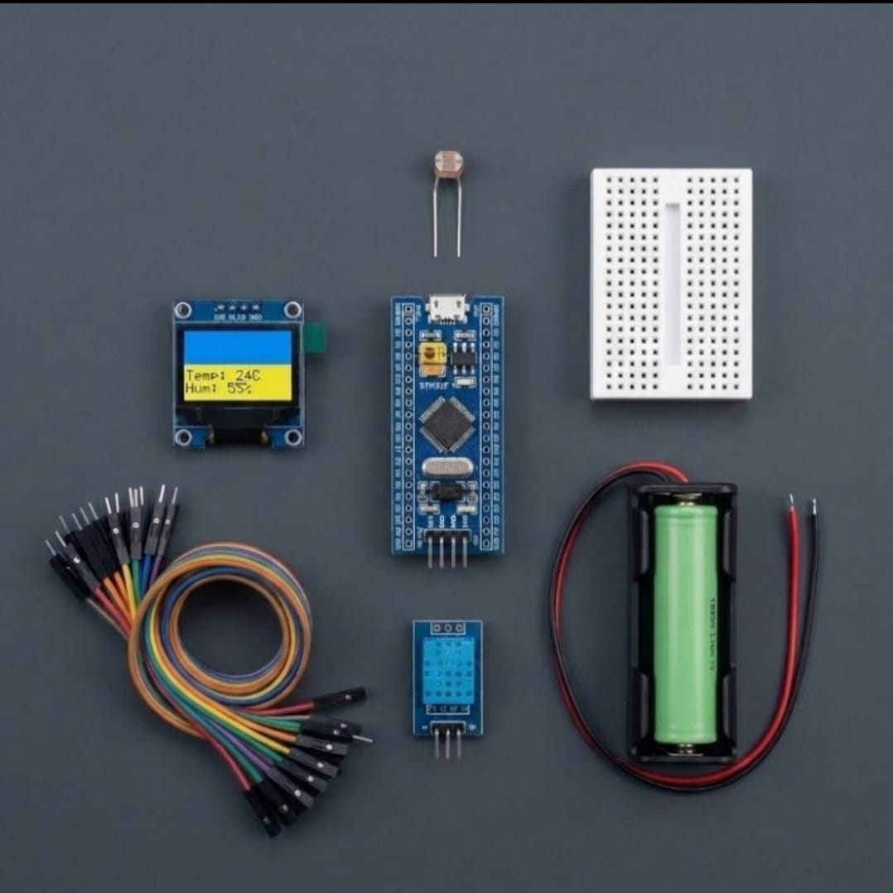

# Zaritech Asynchronous Climate OLED Telemetry & Photo-Transduction Substrate 🎓🌡️

* **Industrial Suite Identifier:** `KIT-10`
* **Curriculum Category:** 32-Bit ARM Clock Optimization, Asynchronous Display Frame-Buffering & Multi-Sensor Telemetry Scaling
* **Governance Standard:** Zaritech Dynamics Institutional Standard

Welcome to the official repository for the **Zaritech STM32'li OLED Ekranlı Hava İstasyonu Seti** — a high-performance 32-bit micro-climate computing complex, asynchronous visual frame-buffering pipeline, and untethered environmental telemetry substrate engineered by **Zaritech Systems** (A division of **Zaritech Dynamics**).

### ⚙️ Engineering Paradigm: High-Density Environmental Interfacing & Memory-Mapped Screens
When validating industrial data loggers, smart greenhouse sensory nodes, or aerospace cabin monitoring modules, standard 8-bit computational cores fail under float formatting bottlenecks and layout latency. This advanced laboratory complex answers this performance limit through its integrated **Asynchronous Graphical Frame-Buffering** infrastructure. By combining a 32-bit high-frequency **STM32F103C8T6 ARM Cortex-M3** processor with a digital **DHT11 Environmental Climate Telemetry String** and a **Photo-Transduction Optimization Plane** (LDR sensor), students evaluate real-time multi-variable gradients. The framework maps parsed ambient arrays onto a dual-color 0.96" I2C OLED display over a shared high-speed I2C communication rail, backed by a stable, un-tethered **18650 Energy Substrate** for absolute field independence.

---

## 🛠️ Hardware & Topology Specs
Our mission-critical climate logging and visual telemetry complex is optimized for low-loss voltage tracks, hardware-timed sensor bus polling, and discrete peripheral expansion loops:

*   **Core ARM Processing Node:** STM32F103C8T6 "Blue Pill" development engine driven by a 32-bit ARM Cortex-M3 processor core, containing 64KB of Flash memory, 20KB of SRAM, and advanced nested vector interrupt controllers (NVIC).
*   **Visual Interface Display Unit:** 0.96-inch High-Contrast I2C OLED Screen (Yellow-Blue Bi-Color SSD1306 Architecture) calibrated for low-latency asynchronous pixel array mapping.
*   **Sensory Atmospheric String:** DHT11 Digital Temperature and Humidity Sensor Module utilizing a calibrated single-bus digital signal output for ambient micro-climate analytics.
*   **Photo-Transduction Vector Node:** 5mm Premium LDR Photocell Sensor optimized for converting ambient or targeted light lux levels into real-time linear analog resistance matrices.
*   **Autonomous Energy Substrate:** 1x Factory-Verified High-Capacity 18650 Lithium-Ion Battery Node paired with a single low-resistance cell dock (Complimentary Production Component).
*   **Prototyping Substrate:** 1x Premium High-Durability Mini Breadboard providing a localized, low-resistance matrix layout for solderless circuit pathing.
*   **Interconnect Infrastructure:** 10-piece factory-verified premium high-flexibility color-coded jumper matrix path calibrated for noise-free signal delivery under high I2C bus frequencies.

---

## 🗺️ Visual Architecture & Pin Topology
The streamlined hardware signal pathways, shared I2C bus lines, and ARM Cortex registers for this climate complex are detailed below:

### Central I2C Telemetry & Sensor Input Interface Matrix

| Peripheral Module Node | Component Pin Name | Target STM32 GPIO Pin | Operational Engineering Context |
| :--- | :--- | :--- | :--- |
| **0.96" OLED Screen** | SDA (Serial Data) | PB7 (I2C1_SDA Mode) | Shared High-Speed Local Data Bus |
| | SCL (Serial Clock) | PB6 (I2C1_SCL Mode) | System Hardware Clock Synchronization |
| **DHT11 Climate Sensor**| DATA (Signal Line) | PA0 (Input Mode) | Single-Bus Asynchronous Pulse Stream |
| **LDR Photo Sensor**  | Analog Output Line | PA1 (ADC1_IN1 Mode) | Photovoltaic Voltaric Telemetry Input |
| **18650 Energy Cell** | Positive (+) / GND | 5V (VIN) / GND | Unified Decoupled Power Delivery Rail |

### Industrial Firmware Implementation
The full, multi-layered bare-metal C/C++ firmware solution utilizing official STM32 HAL libraries to drive hardware I2C frame buffer transmissions, 12-bit ADC light sampling arrays, and precise single-bus DHT bit-stream timing calculations is safely isolated within our production code tree.

🔗 **[Click here to view the full operational source code](./firmware/main.cpp)**

---

## 📸 Hardware Layout

---

## 📥 Commercial Acquisition & Distribution
To purchase factory-certified **Zaritech STM32'li OLED Ekranlı Hava İstasyonu Sets**, secure bulk laboratory workshop kits, or comprehensive technical training curriculum blueprints, please link with our logistics network via our official [Zaritech Labs Instagram](https://instagram.com).

---

## ⚖️ License & Corporate Governance
This infrastructure is maintained under the **MIT License** and governed under the rigorous engineering frameworks of **Zaritech Dynamics**.

*May Allah grant us success on this path.*
