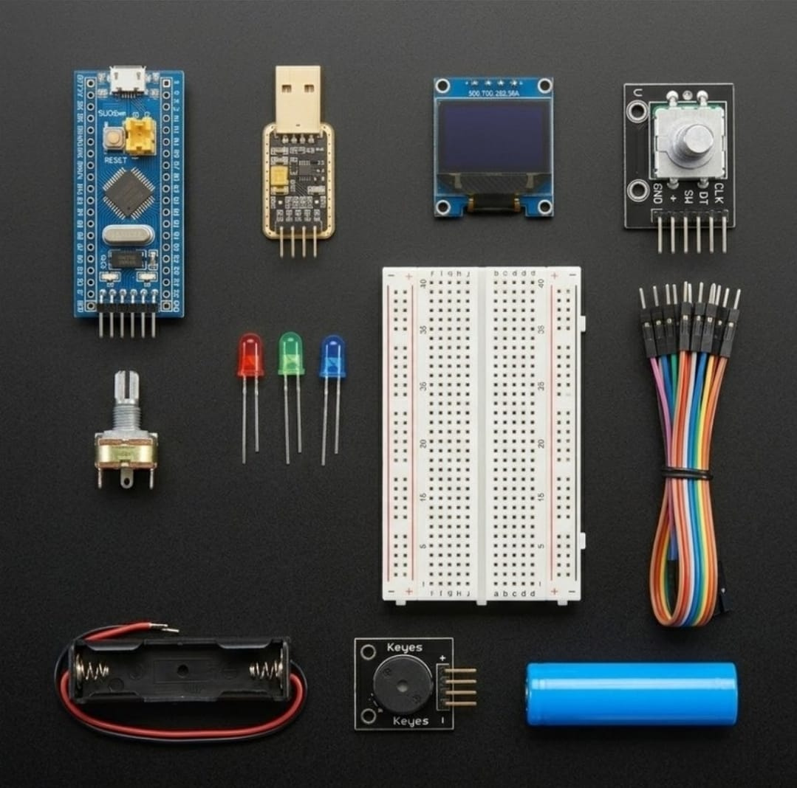

# Zaritech Quadrature Decoder Signals, Haptic UI Buffering & UART Bootloader Substrate 🎓⚙️

* **Industrial Suite Identifier:** `KIT-11`
* **Curriculum Category:** Quadrature Pulse Decoding, Memory-Mapped OLED Menus & Asynchronous UART Bootloader Injections
* **Governance Standard:** Zaritech Dynamics Institutional Standard

Welcome to the official repository for the **Zaritech STM32 Menülü Gösterge ve Geliştirme Seti** — a high-performance 32-bit instrumentation complex, asynchronous menu-buffering pipeline, and hardware-debounced human-machine interface (HMI) substrate engineered by **Zaritech Systems** (A division of **Zaritech Dynamics**).

### ⚙️ Engineering Paradigm: Quadrature Signal Processing & Non-Blocking Menu Gating
When building professional control panels, laboratory data entry interfaces, or avionics parameter tuners, mechanical switch bouncing and computational display delays freeze critical system threads. This advanced laboratory complex answers this constraint through its integrated **Quadrature Decoder Signals & Haptic UI Buffering** infrastructure. By combining a 32-bit high-frequency **STM32F103C8T6 ARM Cortex-M3** processor with an active **Rotary Encoder Subsystem**, students capture bidirectional grey-code pulse transitions asynchronously. The framework maps the decoded angular steps onto a memory-mapped 0.96" I2C OLED canvas grid, allowing users to scroll nested parameter menus smoothly, execute system commits via a wear-free solid-state routine, and flash code directly over **Asynchronous UART Bootloader Injections** using the integrated **CH340G USB Bridge**.

---

## 🛠️ Hardware & Topology Specs
Our mission-critical instrumentation complex is optimized for low-loss power delivery, hardware-timed encoder channel interrupts, and grid-independent field deployment:

*   **Core ARM Processing Node:** STM32F103C8T6 "Blue Pill" development engine driven by a high-frequency 32-bit ARM Cortex-M3 processor core, featuring integrated hardware timers with input capture modes for quadrature decoding.
*   **Asynchronous Serial Telemetry Bridge:** CH340G USB-to-TTL Serial Transceiver Module providing native USB communication layers to inject bare-metal firmware loads directly onto the ARM Cortex flash registers via the embedded system bootloader.
*   **Haptic Control Actuator:** Full 360-degree Rotary Encoder Module featuring distinct detent feedback, precise quadrature outputs (CLK/DT), and an integrated momentary push-button switch (SW).
*   **Visual Interface Display Unit:** 0.96-inch High-Contrast I2C OLED Screen (SSD1306 Architecture) calibrated for low-latency asynchronous pixel array mapping.
*   **Analog Calibration & Acoustic Alert Nodes:** 1x 10k Premium Potentiometer for volteic division tests, 1x Active Buzzer Module for prompt localized threshold alerts, and 3x Diffused Status LEDs (Red, Green, Blue).
*   **Prototyping & Energy Substrates:** 1x Large Prototyping Breadboard (830 Tie-Points Layout) providing absolute mechanical and electrical stability, and 1x Factory-Verified High-Capacity 18650 Battery Node with single low-resistance dock (Complimentary Production Component).

---

## 🗺️ Visual Architecture & Pin Topology
The streamlined hardware signal pathways, shared I2C bus lines, and ARM Cortex registers for this HMI complex are detailed below:

### Central HMI Interface & Shared Communication Grid

| Peripheral Module Node | Component Pin Name | Target STM32 GPIO Pin | Operational Engineering Context |
| :--- | :--- | :--- | :--- |
| **Rotary Encoder**    | CLK (Channel A)    | PA0 (TIM2_CH1 Mode)  | Quadrature Interrupt Encoder Phase A |
| | DT (Channel B)     | PA1 (TIM2_CH2 Mode)  | Quadrature Interrupt Encoder Phase B |
| | SW (Push Button)   | PA2 (Input Pull-Up)  | Menu Parameter Selection Commit |
| **0.96" OLED Screen** | SDA / SCL          | PB7 / PB6 (I2C1 Bus) | Shared High-Speed Local Visual Bus |
| **CH340G USB Bridge**  | TXD / RXD Interface | PA10 (RX1) / PA9 (TX1)| Asynchronous UART Bootloader Line |

### Industrial Firmware Implementation
The full, multi-layered bare-metal C/C++ firmware solution utilizing official STM32 HAL libraries to drive hardware timer quadrature encoders, asynchronous I2C frame buffer display transmissions, and debounced menu index switching arrays is safely isolated within our production code tree.

🔗 **[Click here to view the full operational source code](./firmware/main.cpp)**

---

## 📦 Package Components
*Here is the visual index of the high-grade components included in the KIT-10 platform:*

 

## ⚙️ Hardware Layout & Interfacing Schematic
*The following standardized 32-bit ARM topology maps the exact point-to-point connections over the shared I2C bus and analog transduction node:*

---

## 📥 Commercial Acquisition & Distribution
To purchase factory-certified **Zaritech STM32 Menülü Gösterge ve Geliştirme Sets**, secure engineering faculty laboratory bulk configurations, or download advanced 32-bit HMI firmware blueprints, please connect with our logistics division via our official [Zaritech Labs Instagram](https://instagram.com).

---

## ⚖️ License & Corporate Governance
This infrastructure is maintained under the **MIT License** and governed under the rigorous engineering frameworks of **Zaritech Dynamics**.

*May Allah grant us success on this path.*
