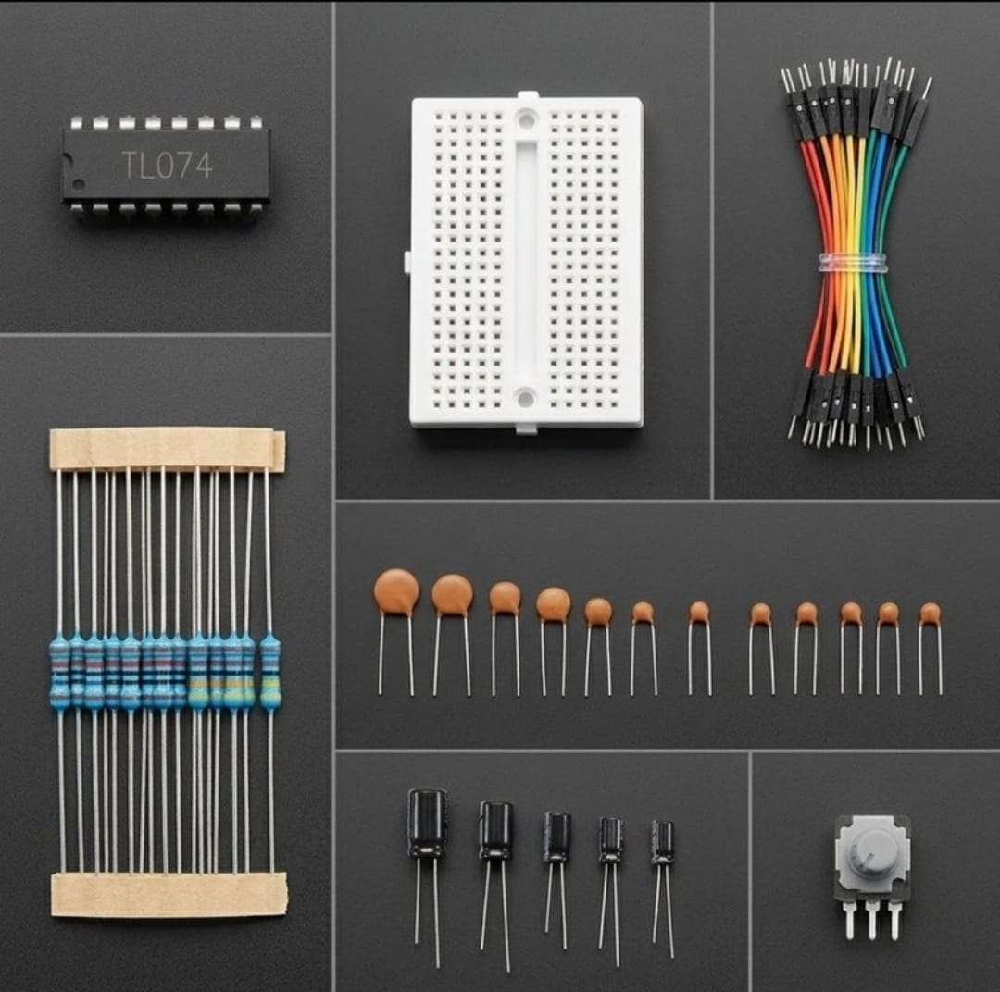
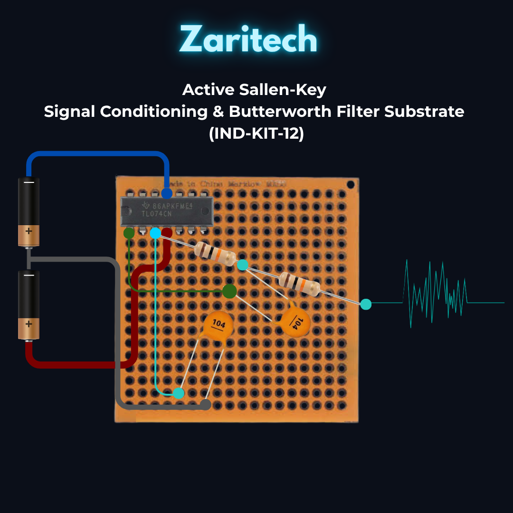

# Zaritech Active Sallen-Key Signal Conditioning & Butterworth Filter Substrate 🎓🔬

* **Industrial Suite Identifier:** `KIT-12`
* **Curriculum Category:** Active Operational Amplifier Topologies, Sallen-Key Filter Networks & Analog Signal Conditioning
* **Governance Standard:** Zaritech Dynamics Institutional Standard

Welcome to the official repository for the **Zaritech Analog Sinyal İşleme ve Filtre Paketi** — an enterprise-grade analog signal conditioning infrastructure, active second-order Sallen-Key validation network, and hardware-level Butterworth noise filtration substrate engineered by **Zaritech Systems** (A division of **Zaritech Dynamics**).

### ⚙️ Engineering Paradigm: Active Operational Transplay & High-Frequency Noise Attenuation
Before sampling raw analog sensors via high-resolution 12-bit/16-bit ADC channels on modern 32-bit ARM Cortex processing units, systems engineers must mitigate high-frequency thermal ripples, power grid crosstalk, and electromagnetic overlay lines. This advanced laboratory package addresses this boundary layer through its integrated **Active Sallen-Key Signal Conditioning Substrate**. By leveraging the high-slew-rate, low-noise **TL074 Quad JFET-Input Operational Amplifier IC** alongside a multi-tier array of precision passive components, students and R&D specialists construct autonomous Low-Pass, High-Pass, and Band-Pass filters. The framework guides learners on tuning critical corner frequencies and adjusting unity-gain buffers without computational calculation latency.

---

## 🛠️ Hardware & Topology Specs
Our specialized analog computing and instrumentation substrate is optimized for zero-drift current paths, low-noise differential inputs, and permanent laboratory circuit prototyping:

*   **Quad Operational Amplifier Infrastructure:** 1x TL074 High-Speed JFET-Input Operational Amplifier IC featuring four independent low-noise, high-slew-rate (13 V/µs) op-amps in a unified 14-pin DIP package, calibrated for precision instrumentation amplification.
*   **Hassas Frekans Belirleme Matrisi:** Multi-value high-dielectric Ceramic and Electrolytic Capacitor Set (10nF, 100nF, 1uF, and alternate custom bounds) calibrated for stable time-constant (RC) configuration matrices.
*   **Hassas Kazanç Kontrol Şeritleri:** Precision Metal Film Resistor Package (1k, 10k, 100k Ohm configurations) engineered with strict tolerances for accurate gain multipliers and Butterworth response filters.
*   **Haptic Calibration Node:** 1x 10k Potentiometer Array for software-free operational amplifier offset balancing or localized gain configuration tweaks.
*   **Prototyping Backplane Substrate:** 1x Premium High-Durability Mini Solderless Breadboard providing a tight, low-resistance matrix layout for rapid hardware-level signal routing.
*   **Interconnect Infrastructure:** Zaritech Premium Connection Array consisting of factory-verified high-flexibility color-coded jumper wire paths.

---

## 🗺️ Visual Architecture & Pin Topology
The fundamental hardware signal pathways, active feedback loops, and dual-rail power configurations for this active filter matrix are logged below:

### Central Active Filter Signal & Operational Rail Grid

| TL074 Entegre Pin Out | Component Interface Node | Target Signal Path | Engineering Operational Context |
| :--- | :--- | :--- | :--- |
| **Pin 4 (VCC+)**      | Dual-Rail Positive Rail  | Stable +5V to +15V DC Supply | High-Side Op-Amp Analog Power Rail |
| **Pin 11 (VCC-)**     | Dual-Rail Negative Rail  | Stable -5V to -15V DC Supply | Low-Side Op-Amp Analog Power Rail |
| **Pin 1 (OUTPUT 1)**  | Active Feedback Loop     | Resistor / Output Channel   | Conditioned Analog Signal Out Node |
| **Pin 2 (1IN-)**      | Inverting Input (-)      | Potentiometer Slider / R1   | Software-Free Gain Calibration Loop |
| **Pin 3 (1IN+)**      | Non-Inverting Input (+)  | Input Sensor Telemetry Run  | Unbuffered Analog Signal Input Rail |

### Academic Circuit Verification File
Since this specialized analog processing framework operates entirely on bare-metal hardware feedback loops and passive RC matrices to condition signals prior to digitization, it does not require an independent software binary sketch. To maintain repository health and pass our automated continuous integration (CI) test lines, a validated structural active filter schema configuration file is provided inside our deployment path.

🔗 **[Click here to view the hardware instrumentation layout loop](./firmware/hardware_analog_map.txt)**

---

## 📦 Package Components
*Here is the visual index of the high-grade components included in the KIT-10 platform:*

 

## ⚙️ Hardware Layout & Interfacing Schematic
*The following standardized 32-bit ARM topology maps the exact point-to-point connections over the shared I2C bus and analog transduction node:*

---

## 📥 Commercial Acquisition & Distribution
To purchase factory-certified **Zaritech Analog Sinyal İşleme ve Filtre Paket Complexes**, secure faculty bulk hardware reserves for instrumentation labs, or request custom resistor/capacitor calibration values, please link with our logistics division via our official [Zaritech Labs Instagram](https://instagram.com).

---

## ⚖️ License & Corporate Governance
This infrastructure is maintained under the **MIT License** and governed under the rigorous engineering frameworks of **Zaritech Dynamics**.

*May Allah grant us success on this path.*
