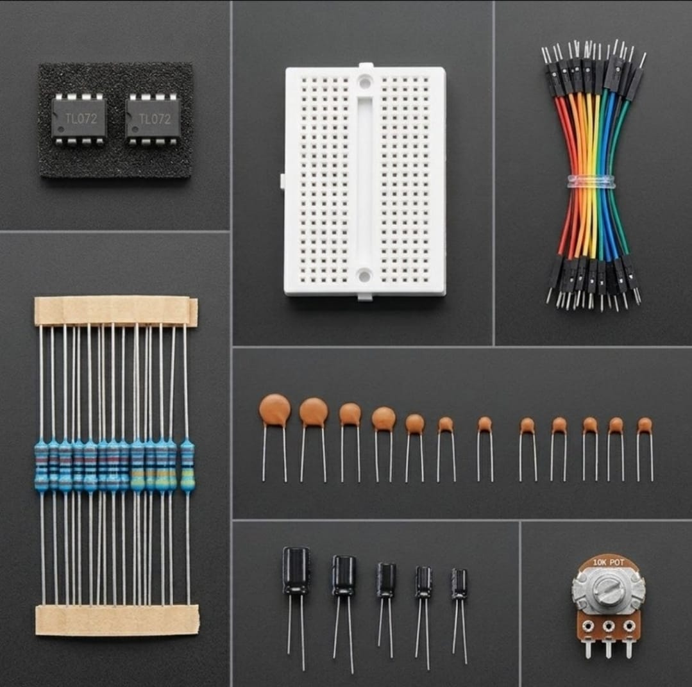

# Zaritech Dual-Channel JFET Signal Pre-Amplification & Instrumentation Substrate 🎓🔬

* **Industrial Suite Identifier:** `KIT-13`
* **Curriculum Category:** Low-Noise JFET Operational Amplifiers, Sensory Signal Pre-Amplification & Active RC Filter Topology
* **Governance Standard:** Zaritech Dynamics Institutional Standard

Welcome to the official repository for the **Zaritech TL072 Sinyal Yükseltme ve Filtre Seti** — an enterprise-grade low-noise analog signal conditioning infrastructure, active dual-channel JFET pre-amplification network, and dynamic instrumentation substrate engineered by **Zaritech Systems** (A division of **Zaritech Dynamics**).

### ⚙️ Engineering Paradigm: Low-Noise JFET Transduction & Microvolt Signal Scaling
When extracting raw telemetry streams from high-impedance biological sensors, acoustic transducers, or weak physical piezo arrays, input strings are highly vulnerable to main grid hum and structural harmonic distortion. This advanced laboratory package addresses this validation bottleneck through its integrated **Dual-Channel JFET Signal Pre-Amplification** architecture. By utilizing twin high-slew-rate, low-noise **TL072 Operational Amplifiers** parallel with precision multi-value passive arrays, students and embedded engineers deploy high-performance differential pre-amps and active Butterworth networks. This framework teaches learners how to scale microvolt transients smoothly into stable volts arrays ready for high-resolution ADC digitization.

---

## 🛠️ Hardware & Topology Specs
Our mission-critical analog enstrümantasyon complex is optimized for low-input-bias currents, high input impedance tracks, and zero-drift transient decoupling:

*   **Low-Noise JFET Op-Amp Infrastructure:** 2x TL072 High-Speed JFET-Input Dual Operational Amplifier ICs featuring extremely low input bias and offset currents, high slew rate (13 V/µs), and low harmonic distortion, containerized in independent 8-pin DIP packages.
*   **Hassas Frekans Belirleme Matrisi:** 8-piece high-dielectric Ceramic and Electrolytic Capacitor Set calibrated to enforce stable time-constant (RC) boundaries and clear low-frequency DC offset drifts.
*   **Enstrümantasyon Kazanç Şeritleri:** 10x Precision Mixed Metal Film Resistors calculated with tight structural tolerances to achieve exact multi-tier amplifier gain multipliers.
*   **Haptic Interface Parameter Tuner:** 1x Premium 10k Potentiometer Array paired with an adjustable Trimpot for software-free operational amplifier offset trimming or analog gain tuning.
*   **Prototyping Backplane Substrate:** 1x Premium High-Durability Large Solderless Breadboard providing an absolute structural and electrical trace baseline.
*   **Interconnect Infrastructure:** 15-piece factory-verified premium high-flexibility color-coded jumper matrix bundle optimized for noise-free analog signal routing.

---

## 🗺️ Visual Architecture & Pin Topology
The hardware signal pathways, active feedback loops, and dual-rail power configurations for this JFET pre-amplifier matrix are logged below:

### Central Pre-Amp Signal & Operational Bus Grid

| TL072 Entegre Pin Out | Component Interface Node | Target Signal Path | Engineering Operational Context |
| :--- | :--- | :--- | :--- |
| **Pin 8 (V+ / VCC)**   | Dual-Rail Positive Rail  | Stable +5V to +15V DC Supply | High-Side Op-Amp Analog Power Rail |
| **Pin 4 (V- / VEE)**   | Dual-Rail Negative Rail  | Stable -5V to -15V DC Supply | Low-Side Op-Amp Analog Power Rail |
| **Pin 1 (1OUTPUT)**    | Active Feedback Channel  | Resistor Network / Out Rail | Amplified Analog Telemetry Output |
| **Pin 2 (1INverting-)**| Inverting Input (-)      | Feedback Resistor Divider   | Gain Control Closed-Loop Mapping |
| **Pin 3 (Non-INvert+)**| Non-Inverting Input (+)  | Zayıf Sensör Giriş Hattı    | High-Impedance Sensor Interface Rail |

### Academic Circuit Verification File
Since this specialized analog processing framework operates entirely on bare-metal hardware feedback loops and passive RC matrices to condition signals prior to digitization, it does not require an independent software binary sketch. To maintain repository health and pass our automated continuous integration (CI) test lines, a validated structural pre-amp schema configuration file is provided inside our deployment path.

🔗 **[Click here to view the hardware instrumentation layout loop](./firmware/hardware_preamp_map.txt)**

---

## 📸 Hardware Layout

---

## 📥 Commercial Acquisition & Distribution
To purchase factory-certified **Zaritech TL072 Sinyal Yükseltme ve Filtre Paket Complexes**, secure faculty bulk hardware reserves for biomedical/electronic instrumentation labs, or request custom passive resistor configurations, please link with our logistics division via our official [Zaritech Labs Instagram](https://instagram.com).

---

## ⚖️ License & Corporate Governance
This infrastructure is maintained under the **MIT License** and governed under the rigorous engineering frameworks of **Zaritech Dynamics**.

*May Allah grant us success on this path.*
