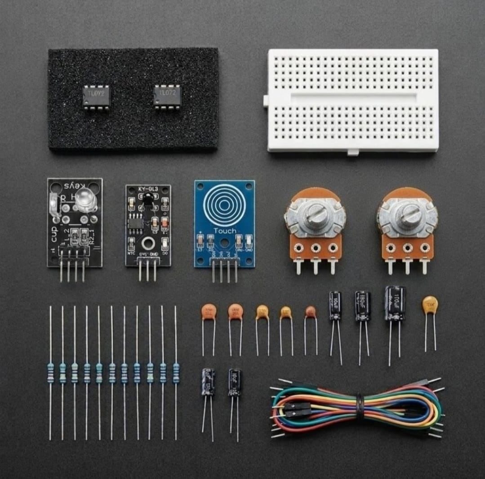

# Zaritech Bio-Potential Differential Amplification & Asynchronous PPG Telemetry Substrate 🎓🔬

* **Industrial Suite Identifier:** `KIT-14`
* **Curriculum Category:** Biomedical Signal Conditioning, Bio-Potential Differential Amplification & Active Sallen-Key Filters
* **Governance Standard:** Zaritech Dynamics Institutional Standard

Welcome to the official repository for the **Zaritech Biyomedikal Sinyal İşleme ve Nabız Seti** — an enterprise-grade low-noise medical instrumentation infrastructure, asynchronous photo-plethysmograph (PPG) signal conditioning network, and bio-potential differential amplification substrate engineered by **Zaritech Systems** (A division of **Zaritech Dynamics**).

### ⚙️ Engineering Paradigm: Bio-Potential Signal Isolation & Active Artifact Attenuation
When extracting fragile raw biometric streams directly from the human physiological substrate—such as microvolt infrared pulse reflections (PPG), body static touch vectors, or thermal gradient shifts—input channels experience severe 50Hz/60Hz power grid hum and motion artifact noise. This advanced laboratory complex addresses this enstrümantasyon bottleneck through its integrated **Low-Noise Bio-Potential Differential Amplification** infrastructure. By deploying twin high-slew-rate **TL072 JFET Operational Amplifiers** arranged as a hardware-level instrumentation topology, students and R&D specialists construct high-common-mode-rejection (CMRR) front-ends. The framework guides learners on routing **Asynchronous Photo-Plethysmograph (PPG) Telemetry** from the **KY-039 Sensor**, filtering out noise via active Sallen-Key Butterworth layers to yield pure analog voltage steps ready for 12-bit/16-bit ADC digitization.

---

## 🛠️ Hardware & Topology Specs
Our mission-critical biomedical enstrümantasyon complex is optimized for low-input-bias currents, high differential input impedance tracks, and multi-domain passive filtering:

*   **Low-Noise JFET Op-Amp Infrastructure:** 2x TL072 High-Speed JFET-Input Dual Operational Amplifier ICs delivering low noise, high input impedance, and high slew rates (13 V/µs) in separate 8-pin DIP packages, optimized for precision biometric pre-amplification.
*   **Biometric & Physiological Telemetry Strings:**
    *   **KY-039 Pulse/Heartbeat Sensor Module:** Infrared emitter and phototransistor optical array configured for high-sensitivity photo-plethysmography data streams.
    *   **KY-036 Capacitive Touch Bio-Sensor:** Solid-state charge-transfer sensing surface for capturing static body potentials and contact switching parameters.
    *   **KY-013 Analog NTC Thermistor Module:** High-accuracy negative temperature coefficient thermistor string for localized thermal telemetry tracking.
*   **Enstrümantasyon Kazanç & Kalibrasyon Blokları:** 2x Premium 10k Potentiometers paired with 1x precision adjustable Trimpot for software-free instrumentation bridge balancing and analog gain scaling.
*   **Frekans Belirleme Matrisi & Passives:** 8x High-Dielectric Ceramic and Electrolytic Capacitors calibrated for high-pass DC blocking and low-pass anti-aliasing filter loops, paired with 10x Precision Metal Film Resistors for balanced gain networks.
*   **Prototyping Substrate & Interconnect Matrix:** 1x Premium High-Durability Large Solderless Breadboard providing an absolute structural and electrical trace baseline, combined with a 15-piece factory-verified premium jumper wire array.

---

## 🗺️ Visual Architecture & Pin Topology
The hardware signal pathways, active feedback configurations, and isolation boundaries for this biomedical complex are detailed below:

### Central Biometric Enstrümantasyon & Op-Amp Bus Grid

| Peripheral Module Node | Component Pin Name | Target Interface Node | Operational Engineering Domain |
| :--- | :--- | :--- | :--- |
| **KY-039 PPG Sensor**  | Analog Signal Out  | TL072 Pin 3 (Non-Inverting)| Photo-Plethysmograph Telemetry In |
| **KY-036 Bio-Touch**   | Digital Output (DO) | Input Interruption Line| Active Body Latch Detection Gate |
| **KY-013 NTC Thermistor**| Analog Out (Thermal)| Wheatstone Bridge Node | Thermal Voltaric Impedance Shift |
| **TL072 Op-Amp Core**  | VCC+ / VEE- Pins   | Dual-Rail Split Power  | Low-Noise Analog Amplification Rail|
| **All System Nodes**   | Common Ground Pins | Shared Ground Rail     | Low-Impedance Reference Plane |

### Academic Circuit Verification File
Since this specialized biomedical processing framework operates entirely on bare-metal hardware feedback loops and passive RC matrices to condition biological signals prior to digitization, it does not require an independent software binary sketch. To maintain repository health and pass our automated continuous integration (CI) test lines, a validated structural instrumentation schema configuration file is provided inside our deployment path.

🔗 **[Click here to view the hardware instrumentation layout loop](./firmware/hardware_biomedical_map.txt)**

---

## 📸 Hardware Layout

---

## 📥 Commercial Acquisition & Distribution
To purchase factory-certified **Zaritech Biyomedikal Sinyal İşleme ve Nabız Sets**, secure medical electronics faculty laboratory bulk configurations, or download advanced biopotential instrumentation blueprints, please bridge with our logistics network via our official [Zaritech Labs Instagram](https://instagram.com).

---

## ⚖️ License & Corporate Governance
This infrastructure is maintained under the **MIT License** and governed under the rigorous engineering frameworks of **Zaritech Dynamics**.

*May Allah grant us success on this path.*
