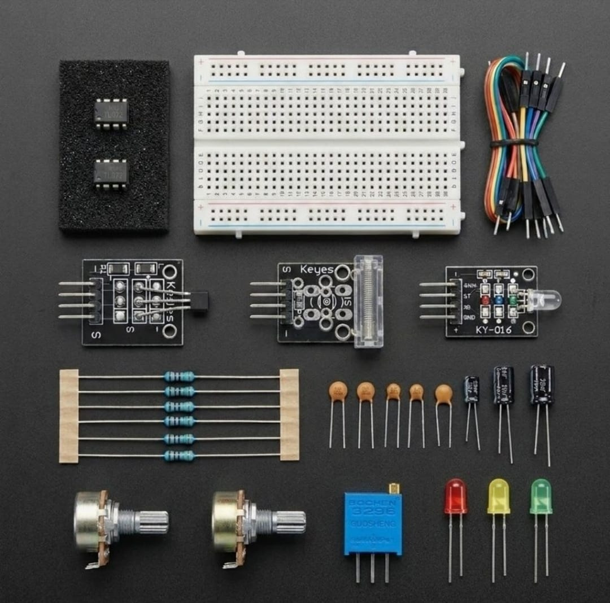

# Zaritech Industrial Magnetic Flux Quantization & Mechanical Debounce Filtration Substrate 🎓🧲

* **Industrial Suite Identifier:** `KIT-15`
* **Curriculum Category:** Analog Hall-Effect Transduction, Transient Vibration Gating & Operational Amplifier Signal Expansion
* **Governance Standard:** Zaritech Dynamics Institutional Standard

Welcome to the official repository for the **Zaritech Manyetik ve Titreşim Sinyal İşleme Seti** — an enterprise-grade low-noise analog enstrümantasyon infrastructure, asynchronous magnetic flux quantization network, and mechanical debounce filtration substrate engineered by **Zaritech Systems** (A division of **Zaritech Dynamics**).

### ⚙️ Engineering Paradigm: Micro-Tesla Signal Expansion & Mechanical Transient Gating
When routing raw telemetry from analog electromagnetic sensors or mechanical contact-impact arrays, systems engineers experience massive high-frequency noise strings and contact bounce artifacts. This advanced laboratory complex answers this constraint through its integrated **Asynchronous Magnetic Flux Quantization** and **Dynamic Mechanical Debounce Filtration** substrates. By deploying twin high-slew-rate **TL072 JFET Operational Amplifiers** configured in non-inverting scaling strings, students multiply micro-tesla voltaric drops from the **KY-035 Analog Hall Effect Sensor**. The framework guides learners on isolating sismik transients from the **KY-031 Vibration Sensor**, routing conditioned active logic levels directly to a **KY-016 RGB LED Diagnostic Display** without computational latency.

---

## 🛠️ Hardware & Topology Specs
Our mission-critical magnetic and mechanical telemetry complex is optimized for low-input bias currents, high common-mode rejection (CMRR), and multi-zone physical diagnostic output chains:

*   **Low-Noise JFET Op-Amp Infrastructure:** 2x TL072 High-Speed JFET-Input Dual Operational Amplifier ICs featuring extremely low harmonic distortion and high slew rates (13 V/µs) in independent 8-pin DIP packages, optimized for precision enstrümantasyon expansion.
*   **Multi-Domain Sensory Telemetry Strings:**
    *   **KY-035 Analog Hall Effect Sensor Module:** High-sensitivity bismuth-thin-film magnetic detector capturing proportional linear voltaric variations based on Gauss field shifts.
    *   **KY-031 Mechanical Vibration/Impact Sensor:** Spring-based low-mass mechanical contact switch configured to capture sismik shock waves and physical vector displacement drops.
*   **Visual Interface Diagnostics Unit:** 1x KY-016 5mm High-Luminance RGB LED Module supporting three independent color mapping channels (Red, Yellow, Green) for multi-level zoning.
*   **Calibration & Parameter Tuning Nodes:** 2x Premium 10k Potentiometers paired with 1x precision adjustable Trimpot for software-free instrumentation bridge balancing and analog threshold configurations.
*   **Frekans Belirleme Matrisi & Passives:** 8x High-Dielectric Ceramic and Electrolytic Capacitors calibrated for high-pass filtering and noise decoupling, paired with 10x Precision Metal Film Resistors for balanced operational amplifier gain feedback networks.
*   **Prototyping Substrate & Interconnect Grid:** 1x Premium High-Durability Large Solderless Breadboard providing an absolute structural and electrical trace baseline, combined with a 20-piece factory-verified premium jumper wire array.

---

## 🗺️ Visual Architecture & Pin Topology
The hardware signal pathways, active feedback loops, and power bus nodes for this multi-domain complex are detailed below:

### Central Telemetry Processing & Op-Amp Pin Grid

| Peripheral Module Node | Component Pin Name | Target Interface Node | Operational Engineering Domain |
| :--- | :--- | :--- | :--- |
| **KY-035 Hall Sensor** | Analog Signal Out  | TL072 Pin 3 (Non-Inverting)| Proportional Gauss Voltage Stream |
| **KY-031 Impact Node** | Signal Out Channel | TL072 Pin 5 (Op-Amp 2 Non-In)| Mechanical Acceleration Vector Input |
| **KY-016 RGB Module**  | Red / Green / Blue | Logic Control Outputs      | Visual Axis Metric Indicator Gates |
| **TL072 Op-Amp Core**  | VCC+ / VEE- Pins   | Dual-Rail Split Power Bus  | Low-Noise Multi-Channel Gain Rail |
| **All System Nodes**   | Common Ground Pins | Shared Ground Rail         | Low-Imimpedance Reference Plane |

### Academic Circuit Verification File
Since this specialized physical data processing framework operates entirely on bare-metal hardware feedback loops and passive RC matrices to condition physical signals prior to digitization, it does not require an independent software binary sketch. To maintain repository health and pass our automated continuous integration (CI) test lines, a validated structural instrumentation schema configuration file is provided inside our deployment path.

🔗 **[Click here to view the hardware instrumentation layout loop](./firmware/hardware_magnetic_map.txt)**

---

## 📸 Hardware Layout

---

## 📥 Commercial Acquisition & Distribution
To purchase factory-certified **Zaritech Manyetik ve Titreşim Sinyal İşleme Sets**, secure advanced technical university hardware endowments, or request custom institutional engineering textbooks, please bridge with our logistics network via our official [Zaritech Labs Instagram](https://instagram.com).

---

## ⚖️ License & Corporate Governance
This infrastructure is maintained under the **MIT License** and governed under the rigorous engineering frameworks of **Zaritech Dynamics**.

*May Allah grant us success on this path.*
