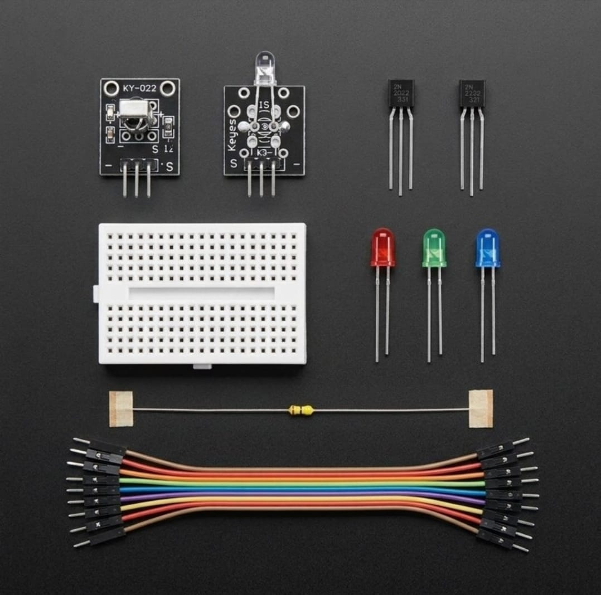

# Infrared Transceiver Link & Transistorized Signal Drive Substrate 🎓📡

* **Industrial Suite Identifier:** `KIT-16`
* **Curriculum Category:** Infrared Carrier Demodulation, Pulse-Coded Signal Parsing & Transistorized Low-Side Switching Topologies
* **Governance Standard:** Zaritech Dynamics Institutional Standard

Welcome to the official repository for the **Zaritech Kızılötesi (IR) İletişim ve Transistör Sürücü Seti** — an enterprise-grade optical wireless infrastructure, asynchronous carrier demodulation pipeline, and discrete semiconductor switching substrate engineered by **Zaritech Systems** (A division of **Zaritech Dynamics**).

### ⚙️ Engineering Paradigm: Optoelectronic Modulation & Yarı İletken Sürücü Lojik
When validating wireless human-machine interfaces (HMI) or optical wireless data telemetry links, standard setups must isolate logic processing cores from the inductive/capacitive noise strings of high-output active elements. This advanced laboratory package addresses this boundary constraint through its integrated **Asynchronous Infrared Carrier Demodulation** and **Transistorized Low-Side Switching Topologies**. By deploying a highly integrated **KY-022 38kHz IR Receiver Module**, students decode incoming pulse-width modulated (PWM) optical bursts from standard consumer remotes. The platform guides engineers on using high-speed **2N2222 NPN Silicon Transistors** acting as current amplifiers, safely driving multi-color LED indicator strings and independent **KY-005 IR Emitter Nodes** without risking digital I/O port saturation.

---

## 🛠️ Hardware & Topology Specs
Our mission-critical optical communication complex is optimized for low-loss signal conditioning, sharp digital edge transitions, and flexible multi-tier hardware gating:

*   **Demodulating Sensory Node:** 1x KY-022 Infrared Receiver Module containing an internal PIN photodiode and preamplifier preamble IC, calibrated to strip away ambient light noise and output clean 38kHz carrier-demodulated digital pulse frames.
*   **Optical Emitter Substrate:** 1x KY-005 Infrared Transmitter LED Module optimized for high-intensity 940nm wavelength coherent light pulse generation.
*   **Discrete Switching Transistors:** 2x 2N2222 NPN Bipolar Junction Transistors (BJT) configured for high-speed digital logic-level amplification and low-side switching saturation loops.
*   **Visual Logic Indicator Matrix:** 3x Premium Diffused Status LEDs (Red, Green, Blue cascade strings) for real-time visual protocol verification.
*   **Prototyping Substrate & Interconnects:** 1x Premium High-Durability Mini Breadboard providing a localized, low-resistance matrix layout for solderless circuit pathing, paired with a 10-piece factory-verified premium jumper wire array.
*   **Passive Protection Matrix:** 5x Precision Current-Limiting Resistors strategically matched to handle safe transistor base-current biasing and protect diode junctions from thermal degradation.

---

## 🗺️ Visual Architecture & Pin Topology
The streamlined hardware signal pathways, shared voltage buses, and operational input-output mapping grids are detailed below:

### Central Optical Telemetry & Semiconductor Drive Interface Matrix

| Peripheral Module Node | Component Pin Name | Target Interface Node | Operational Engineering Domain |
| :--- | :--- | :--- | :--- |
| **KY-022 IR Receiver** | OUT (Signal Out)   | Digital Pin D2 (Interrupt 0) | Asynchronous Pulse Frame Demodulation |
| | VCC / GND          | 5V / GND Power Rail   | Main Sensor Logic Power Line |
| **2N2222 Transistor**  | Base (B) via Resistor| Digital Pin D3 (PWM Output) | Transistorized Low-Side Base Current Trigger |
| | Collector (C)      | KY-005 Signal / LED Cathode| Switched Low-Side Sinking Output Path |
| | Emitter (E)        | Shared System Ground | Unified Reference Ground Plane |

### Academic Firmware Implementation
The full, modular production software solution executing high-speed non-blocking infrared protocol parsing (NEC, RC5/6 standards), software debounce edges, and synchronized transistor-driven visual outputs is safely isolated within our production codebase.

🔗 **[Click here to view the full operational source code](./firmware/main.cpp)**

---

## 📸 Hardware Layout

---

## 📥 Commercial Acquisition & Distribution
To purchase factory-certified **Zaritech Kızılötesi (IR) İletişim ve Transistör Sürücü Sets**, school workshop bulk laboratory packages, or request custom optical remote control firmware layouts, please link with our logistics division via our official [Zaritech Labs Instagram](https://instagram.com).

---

## ⚖️ License & Corporate Governance
This infrastructure is maintained under the **MIT License** and governed under the rigorous engineering frameworks of **Zaritech Dynamics**.

*May Allah grant us success on this path.*
