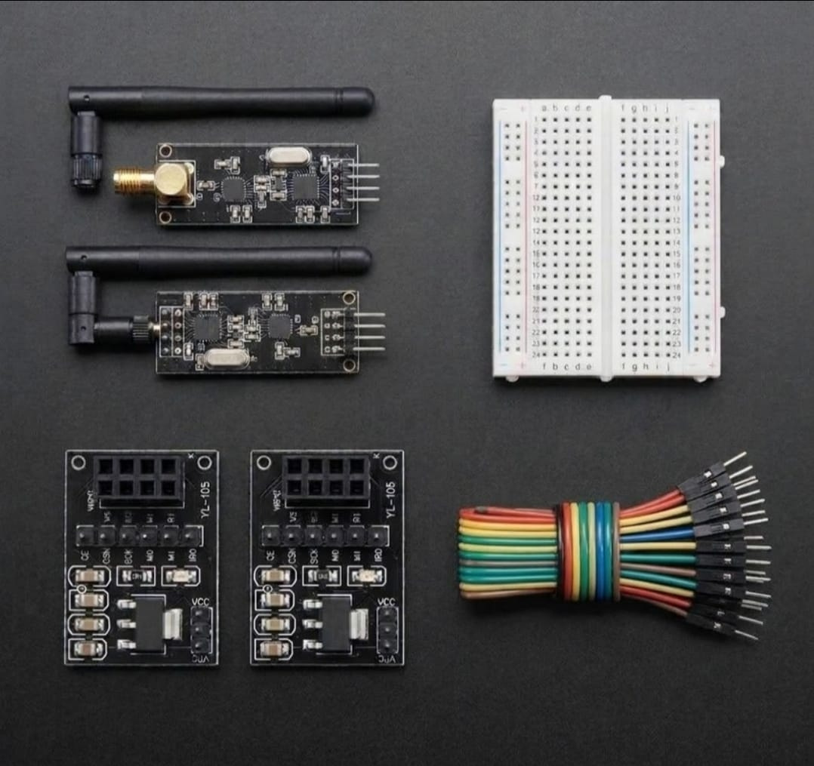

# Universal RF Transceiver Backplane Array & SPI Hardware Serialization 🎓📡

* **Industrial Suite Identifier:** `KIT-17`
* **Curriculum Category:** Decoupled RF Transceiver Links, SPI Packet Serialization & Voltaric Transient Buffering
* **Governance Standard:** Zaritech Dynamics Institutional Standard

Welcome to the official repository for the **Zaritech NRF24L01 Alıcı-Verici Kablosuz Modül Seti** — an enterprise-grade universal RF infrastructure, synchronized SPI hardware serialization pipeline, and voltage-buffered decoupled radio backplane matrix engineered by **Zaritech Systems** (A division of **Zaritech Dynamics**).

### ⚙️ Engineering Paradigm: Multi-Platform Cross-Scaling & RF Link Stabilization
When scaling distributed telemetry nodes across heterogeneous microcontrollers (Arduino AVR, STM32 ARM Cortex, or dual-core ESP32 setups), the primary failure mode stems from voltage ripple during sudden high-power RF transmission bursts. This advanced laboratory package addresses this validation bottleneck through its integrated **Decoupled Wireless Backplane Matrices** (YL-105 Transient Adapters). By stabilizing loose power tracks and filtering incoming digital logic lines, this module allows any external computing host to execute full **SPI Hardware Serialization Streams** over a high-gain external SMA antenna network, ensuring long-range wireless data transaction immunity without computational core resets.

---

## 🛠️ Hardware & Topology Specs
Our mission-critical radio frequency instrumentation complex is optimized for low-noise multi-drop peripheral configurations, zero-drift power tracks, and flexible cross-platform layout deployment:

*   **Long-Range RF Transceiver Components:** 2x High-Performance NRF24L01+ 2.4GHz Wireless Silicon Transceivers equipped with high-gain external omnidirectional SMA antennas, supporting Nordic Enhanced ShockBurst™ hardware protocol accelerators.
*   **Decoupled Wireless Backplane Matrices:** 2x YL-105 NRF24L01 Dedicated Adapter Modules featuring onboard AMS1117-series step-down linear regulators and surface-mount filtering capacitor networks to deliver a low-ripple 3.3V power plane.
*   **Prototyping Substrate:** 1x Premium High-Durability Medium Solderless Breadboard providing an uninhibited, low-resistance matrix layout for rapid signal routing.
*   **Interconnect Infrastructure:** 20-piece factory-verified premium high-flexibility color-coded jumper wire array optimized for noise-free Serial Peripheral Interface (SPI) high-frequency hardware clock synchronization.

---

## 🗺️ Visual Architecture & Pin Topology
The hardware signal pathways, shared distributed buses, and hardware CE/CSN control registers for this wireless backplane infrastructure are detailed below:

### Central SPI Communication & Telemetry Interconnect Grid

| NRF24L01 Base Module | Component Pin Name | Target Controller Interface Node | Engineering Operational Context |
| :--- | :--- | :--- | :--- |
| **YL-105 Power Port** | VCC / GND          | External Supply (5V / GND)       | Filtered Low-Ripple Logic Power |
| **RF Transceiver Bus**| CE (Chip Enable)   | Dedicated Software GPIO Pin      | RX/TX Mode Active Gating Line |
| | CSN (Chip Select)  | Dedicated SPI CSN GPIO Pin       | Dedicated SPI Peripheral Select Line |
| | SCK (SPI Clock)    | Hardware SPI SCK Pin             | High-Speed Master Hardware Clock Rail |
| | MOSI (Master Out)  | Hardware SPI MOSI Pin            | Master-to-Slave Data Serialization |
| | MISO (Master In)   | Hardware SPI MISO Pin            | Slave-to-Master Data De-serialization |

### Academic Circuit Verification File
Since this universal wireless framework operates entirely on bare-metal hardware decoupling loops and multi-drop SPI channels to stabilize external host processing units, it does not require an independent software binary sketch. To maintain repository health and pass our automated continuous integration (CI) test lines, a validated structural transceiver schema configuration file is provided inside our deployment path.

🔗 **[Click here to view the hardware instrumentation layout loop](./firmware/hardware_transceiver_map.txt)**

---

## 📸 Hardware Layout

---

## 📥 Commercial Acquisition & Distribution
To purchase factory-certified **Zaritech NRF24L01 Alıcı-Verici Kablosuz Modül Sets**, secure advanced technical university workshop reserves, or request custom autonomous drone telemetry firmwares, please coordinate with our supply logistics channel via our official [Zaritech Labs Instagram](https://instagram.com).

---

## ⚖️ License & Corporate Governance
This infrastructure is maintained under the **MIT License** and governed under the rigorous engineering frameworks of **Zaritech Dynamics**.

*May Allah grant us success on this path.*
