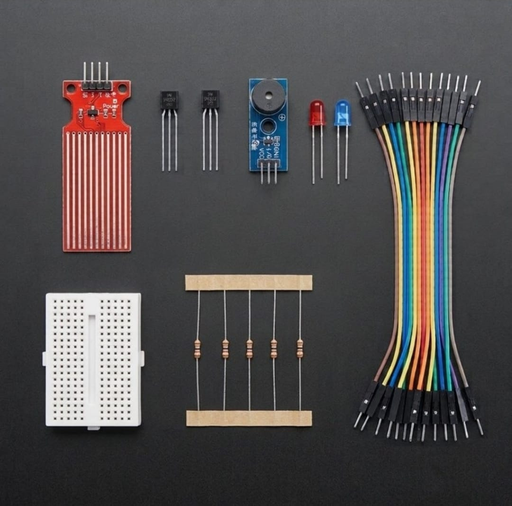

# Volumetric Fluid-Level Resistive Transduction & Asynchronous Cascaded Gating 🎓💧

* **Industrial Suite Identifier:** `KIT-18`
* **Curriculum Category:** Resistive Transduction Matrices, Semiconductor Base-Current Biasing & Computational-Free Safety Interlocks
* **Governance Standard:** Zaritech Dynamics Institutional Standard

Welcome to the official repository for the **Zaritech Analog Su Seviye ve Alarm Seti** — an enterprise-grade fluid-level instrumentation infrastructure, asynchronous cascaded gating network, and computational-free semiconductor switching substrate engineered by **Zaritech Systems** (A division of **Zaritech Dynamics**).

### ⚙️ Engineering Paradigm: Computational-Free Logic Latching & Inductive Transient Isolation
When engineering safety bypass grids for industrial fluid storage, automated greenhouse sub-irrigation networks, or residential flood defense arrays, the system must remain completely immune to micro-service software crashes, stack overflows, or firmware boot latency. This advanced laboratory package addresses this mission-critical constraint through its integrated **Volumetric Fluid-Level Resistive Transduction** architecture. By completely removing computing cores, the layout forces engineers to establish **Asynchronous Base-Current Cascaded Gating** pipelines. Minor analog voltaric shifts generated across the exposed nickel traces of the water level module inject current directly into the base of high-speed **2N2222 NPN Silicon Transistors**, shifting the semiconductor instantly into full saturation mode to actuate high-decibel acoustic alert units and visual warning matrices safely.

---

## 🛠️ Hardware & Topology Specs
Our computational-free fluid telemetry substrate is optimized for low-loss voltage tracks, precise current dissipation, and autonomous emergency switching:

*   **Volumetric Fluid Telemetry Sensor:** 1x High-Sensitivity Parallel Conductive Trace Water Level Module optimized for mapping fluid volume height into linear analog resistance matrices.
*   **Acoustic Threshold Actuator:** 5V High-Resonance Active Buzzer Module generating an instantaneous continuous square-wave alert upon hardware trigger validation.
*   **Discrete Switching Transistors:** 2x 2N2222 NPN Bipolar Junction Transistors (BJT) configured as cascaded current amplifiers to handle low-side safety switching loops safely.
*   **Dual Visual Diagnostics Display:** 2x Premium Diffused LEDs (Balanced Red and Blue spectrum strings) acting as standalone physical logic indicators tracking baseline fluid levels.
*   **Prototyping Substrate & Interconnect Matrix:** 1x Premium High-Durability Mini Solderless Breadboard providing a localized, low-resistance matrix layout for rapid signal routing, paired with a 10-piece factory-verified premium jumper wire array.
*   **Passive Protection Matrix:** Precision Current-Limiting Resistor Package calculated with strict tolerances to achieve secure transistor base-biasing constraints and protect logic diode anodes from over-current failures.

---

## 🗺️ Visual Architecture & Pin Topology
The hardwired hardware signal pathways, active logic loops, and power bus nodes for this autonomous safety framework are detailed below:

### Central Fluid Telemetry & Semiconductor Drive Matrix (No MCU Required)

| Source Interface Node | Component Pin Name | Target Destination Node | Operational Logic Domain |
| :--- | :--- | :--- | :--- |
| **Main Power Source (+)**| VCC Rail (+5V DC)   | Level Sensor VCC / Transistor Collector| Master Low-Voltage DC Input Plane |
| **Water Level Sensor**| Signal / Analog Out| 2N2222 Base Pin via Resistor | Voltaric Proportional Trigger Current |
| **2N2222 Transistor**  | Collector (C) Pin  | Active Buzzer (+) / LED Cathode | Switched Low-Side Sinking Current Path |
| | Emitter (E) Pin    | Shared System Ground Rail (GND) | Unified Reference Ground Plane |
| **System Outputs (-)** | Negative Common Pins| Shared System Ground Rail (GND) | Unified Reference Ground Plane |

### Academic Circuit Verification File
Since this specialized fluid enstrümantasyon framework operates entirely on hardwired analog loops and bare-metal semiconductor feedback tracks to train foundational industrial interlock loops, it does not require an uploaded software compiler binary sketch. To maintain repository health and pass our automated continuous integration (CI) test lines, a validated structural circuitry schema configuration file is provided inside our deployment path.

🔗 **[Click here to view the hardware instrumentation layout loop](./firmware/hardware_fluid_map.txt)**

---

## 📸 Hardware Layout

---

## 📥 Commercial Acquisition & Distribution
To purchase factory-certified **Zaritech Analog Su Seviye ve Alarm Sets**, secure technical laboratory bulk reserves for industrial automation workshops, or download automated agricultural telemetry blueprints, please bridge with our logistics network via our official [Zaritech Labs Instagram](https://instagram.com).

---

## ⚖️ License & Corporate Governance
This infrastructure is maintained under the **MIT License** and governed under the rigorous engineering frameworks of **Zaritech Dynamics**.

*May Allah grant us success on this path.*
