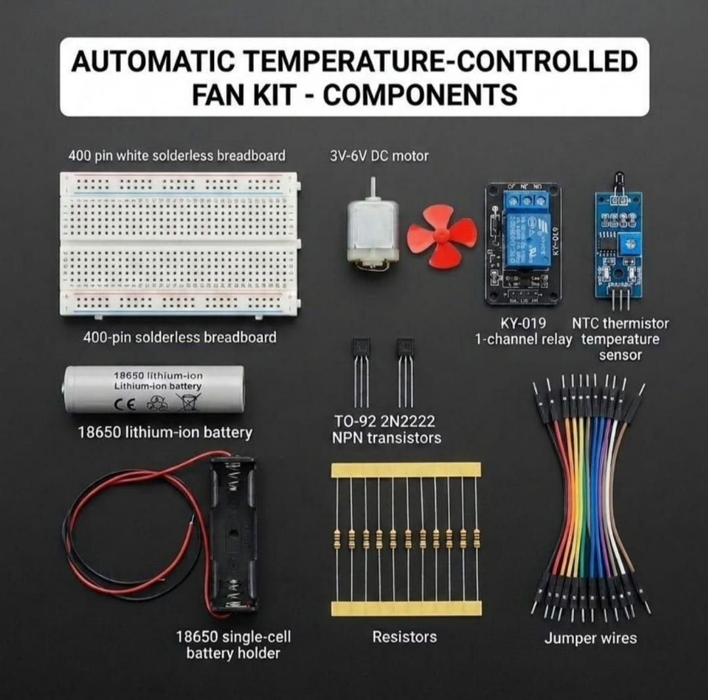

# Thermistorized Thermal-Threshold Transduction & Electromechanical Fluid Propulsion 🎓🌡️

* **Industrial Suite Identifier:** `KIT-20`
* **Curriculum Category:** Thermal-Resistive Transduction, Low-Side Semiconductor Biasing & Electromechanical Safety Interlocks
* **Governance Standard:** Zaritech Dynamics Institutional Standard

Welcome to the official repository for the **Zaritech Otomatik Sıcaklık Kontrollü Fan Seti** — an enterprise-grade thermal-resistive instrumentation infrastructure, electromechanical fluid propulsion interlock network, and computational-free semiconductor switching substrate engineered by **Zaritech Systems** (A division of **Zaritech Dynamics**).

### ⚙️ Engineering Paradigm: Computational-Free Thermal Latching & Inductive Actuation
When engineering automated thermal override loops for critical server enclosures, lithium battery storage racks, or greenhouse exhaust grids, the backup cooling architecture must remain operational under complete primary processor failure modes. This advanced laboratory platform addresses this mission-critical constraint through its integrated **Thermistorized Thermal-Threshold Transduction** architecture. By intentionally omitting computing cores, the layout eliminates software execution latency completely. Ambient temperature spikes across the **NTC Thermistor Sensor Module** adjust internal resistance channels, injecting an analog trigger current directly into a **TO-92 2N2222 NPN Silicon Transistor** string. This saturates the semiconductor junction instantly, low-side switching the electromagnetic coil of the **KY-019 1-Channel Relay Module** to actuate a high-torque **DC Motor & Fluid Propeller Substrate** driven by an isolated **18650 Energy Substrate**.

---

## 🛠️ Hardware & Topology Specs
Our specialized computational-free thermal actuation substrate is optimized for high-current motor drive tracking, thermal drift balancing, and untethered emergency field deployment:

*   **Thermal Transduction Node:** 1x High-Accuracy NTC Thermistor Temperature Sensor Module equipped with an onboard multi-turn trimmer potentiometer for adjusting analog reference switching thresholds.
*   **Galvanic Isolation Gateway:** 1x KY-019 1-Channel Electromagnetic Relay Module supporting true **10A (250VAC / 30VDC)** internal contact tracks, featuring onboard state validation LEDs.
*   **Inductive Fluid Propulsion Subsystem:** 1x High-RPM 3V-6V Brushed DC Prototyping Motor paired with a balanced, high-aerodynamic efficiency fluid propeller fan.
*   **Discrete Switching Transistors:** 2x TO-92 2N2222 NPN Bipolar Junction Transistors (BJT) configured for high-speed digital logic-level amplification and low-side switching saturation loops.
*   **Autonomous Energy Storage:** 1x Factory-Verified Capacity-Tested 18650 Lithium-Ion Energy Cell paired with a low-resistance single cell battery holder dock (Complimentary Production Component).
*   **Prototyping Substrate & Interconnect Matrix:** 1x Premium High-Durability 400-Pin White Solderless Breadboard paired with a factory-verified premium flexible jumper wire array for secure signal paths.
*   **Passive Protection Matrix:** Precision Inline Current-Limiting Resistor Package calculated with strict tolerances to achieve secure transistor base-biasing constraints and protect peripheral nodes.

---

## 🗺️ Visual Architecture & Pin Topology
The hardwired hardware signal pathways, active thermal logic loops, and power bus nodes for this autonomous cooling framework are detailed below:

### Central Thermal Engineering & Power Actuation Interface Matrix (No MCU Required)

| Source Interface Node | Component Pin Name | Target Destination Node | Operational Engineering Domain |
| :--- | :--- | :--- | :--- |
| **18650 Power Cell (+)**| Positive Rail (+5V DC) | Sensor VCC / Relay VCC / Button | Master Low-Voltage DC Input Plane |
| **NTC Thermal Sensor** | Analog/Digital Output  | 2N2222 Base Pin via Resistor | Voltaric Proportional Trigger Current |
| **TO-92 2N2222 BJT**   | Collector (C) Pin     | KY-019 Relay Control IN Terminal| Switched Low-Side Sinking Output Path |
| | Emitter (E) Pin       | Shared System Ground Rail (GND) | Unified Reference Ground Plane |
| **System Outputs (-)** | Negative Common Pins  | Shared System Ground Rail (GND) | Unified Reference Ground Plane |

### Academic Circuit Verification File
Since this specialized thermal enstrümantasyon framework operates entirely on hardwired analog loops and bare-metal semiconductor feedback tracks to train foundational industrial interlock loops, it does not require an uploaded software compiler binary sketch. To maintain repository health and pass our automated continuous integration (CI) test lines, a validated structural circuitry schema configuration file is provided inside our deployment path.

🔗 **[Click here to view the hardware instrumentation layout loop](./firmware/hardware_thermal_fan_map.txt)**

---

## 📸 Hardware Layout

---

## 📥 Commercial Acquisition & Distribution
To purchase factory-certified **Zaritech Otomatik Sıcaklık Kontrollü Fan Sets**, secure technical laboratory bulk reserves for climate-control workshops, or access industrial thermal automation curricula, please link with our logistics network via our official [Zaritech Labs Instagram](https://instagram.com).

---

## ⚖️ License & Corporate Governance
This infrastructure is maintained under the **MIT License** and governed under the rigorous engineering frameworks of **Zaritech Dynamics**.

*May Allah grant us success on this path.*
